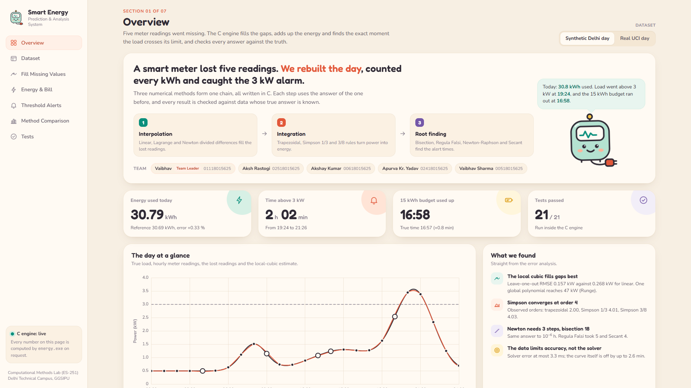

# Smart Energy Consumption Prediction & Analysis System

Computational Methods Lab (ES-251) Project-Based Learning, Delhi Technical Campus (GGSIPU).
| # | Team member | Enrollment No. |
|---|---|---|
| 1 | Vaibhav (Team Leader) | 01118015625 |
| 2 | Aksh Rastogi | 02518015625 |
| 3 | Akshay Kumar | 00618015625 |
| 4 | Apurva Kr. Yadav | 02418015625 |
| 5 | Vaibhav Sharma | 00518015625 |

This menu-driven C program analyses one day of smart-meter readings:
- **Interpolation** (Linear, Lagrange and Newton Divided Difference local cubics, plus a global Lagrange demonstration)
  fills in lost readings.
- **Integration** (Trapezoidal, Simpson 1/3, Simpson 3/8) computes the energy used and the bill.
- **Root finding** (Bisection, Regula Falsi, Newton-Raphson, Secant) finds when the load crosses **3 kW** and when the
  **15 kWh** daily budget runs out.

Every method is checked against data with known true answers. The full plan is in [`docs/PLAN.md`](docs/PLAN.md).



## Quick start (after cloning)

The compiled program is not stored in the repository, so build it first:

```
build.bat                          (Windows; Linux/Mac: see "Build" below)
energy.exe --test                  should end with "TOTAL: 21 passed, 0 failed"
energy.exe                         interactive menu
python web/serve.py                optional web front-end at http://localhost:8000
```

Everything in `output/` and `web/data/results.js` is already generated. `energy.exe --export-all` regenerates it.

## Build

You need GCC. On Windows, MinGW or the GCC that comes with Code::Blocks / Dev-C++ works. From the project folder:

```
build.bat
```

or the same command by hand (also works on Linux/Mac):

```
gcc -std=c99 -Wall -Wextra -O2 src/*.c -o energy.exe -lm
```

On Windows `cmd`, `src/*.c` may not expand. List the files as `build.bat` does, or run the command in Git Bash or PowerShell.
On Linux/Mac, run the program as `./energy.exe` (the name is only a label there; `web/serve.py` also accepts a binary
called `energy`).

The code compiles with **no warnings** under `-Wall -Wextra -pedantic` (tested with MinGW GCC 6.3.0, Windows 11).

## Run

Always run from the project folder, because the program reads `data/` and writes `output/`.

| Command | What it does |
|---|---|
| `energy.exe` | Interactive menu |
| `energy.exe --test` | Runs the 21 test cases (T1–T15, S1–S6) and prints PASS/FAIL |
| `energy.exe --export-all` | Writes every result file for both datasets, plus `output/test_results.txt` and the web snapshot |
| `python scripts/plot_results.py` | *Optional:* turns the exported CSVs into PNG graphs in `output/figures/` (needs Python 3 + matplotlib) |
| `python web/serve.py` | *Optional:* starts the web front-end at http://localhost:8000, with live inputs computed by `energy.exe` |

## Web front-end (optional)

`web/` holds a single-page front-end: HTML, CSS and plain JavaScript, with Chart.js and fonts bundled locally so it works offline.

**The page never computes anything itself.** Every number comes from the C program, in one of two modes:

| Mode | How to start | What you get |
|---|---|---|
| **Live** | `python web/serve.py`, then open http://localhost:8000 | Every input change re-runs `energy.exe --json ...`. The inputs are threshold, budget, peak window, rate, gap-fill method and "estimate at time". Tests can be re-run from the page. |
| **Offline snapshot** | Double-click `web/index.html` | Results from `web/data/results.js`, written by `energy.exe --export-web` (also by `--export-all`). Inputs are locked, with a note explaining why. |

The page has seven sections: Overview, Dataset, Fill Missing Values, Energy & Bill, Threshold Alerts, Method Comparison and Tests.

Screenshots of every section are in `output/web_screenshots/`, for both datasets at 1366 × 768 and 1920 × 1080:
- full-page shots are named `<width>_<dataset>_<section>.png`;
- `screen_*.png` files show exactly one 1920 × 1080 screen.

The engine options used by the page are:

```
energy.exe --json <synthetic|real> <outfile> [threshold budget peak_start peak_end rate fill probe]
energy.exe --json-tests <outfile>
energy.exe --export-web
```

### Menu

```
 1. Load dataset           (synthetic day / real UCI day / custom CSV / regenerate synthetic)
 2. View readings and load-curve chart
 3. Fill missing values (interpolation)      - one method, or compare all
 4. Energy calculation (integration)         - full day + peak window (default 18:00-22:00)
 5. Threshold and energy-budget analysis     - default 3 kW and 15 kWh
 6. Bill estimate (flat Rs/kWh rate)         - default Rs 8.00/kWh
 7. Error analysis and method comparison
 8. Run test cases
 9. Export all results to output/
 0. Exit
```

Press **Enter** at any number prompt to keep the default value shown.

### Using your own data

Copy `data/custom_template.csv`, put in your readings and load it with **Menu 1 → 3**. The file format is:

```
time_hours,power_kW
9.0,0.80
10.5,NA        <- missing reading
```

Rules:
- Times must be strictly increasing.
- The first and last readings must not be `NA`.
- Simpson rules need equally spaced times. If the spacing varies, only the trapezoidal rule is used.

## Folder structure

```
src/        C source code (main, data_io, load_model, interpolation, integration,
            root_finding, analysis, report, tests, web_export)
web/        web front-end: index.html, css/, js/, vendor/ (Chart.js, fonts), data/results.js, serve.py
data/       synthetic_day.csv            synthetic Delhi summer day (made by the program)
            real_day_hourly.csv          real UCI day, hourly, 5 readings hidden
            real_day_hourly_complete.csv ground truth for the hidden readings
            real_day_minute.csv          1-minute reference data
            custom_template.csv          example for your own data
output/     generated results: synthetic/, real/, figures/, web_screenshots/, test_results.txt
scripts/    extract_uci_day.py (one-time data preparation), plot_results.py (graphs)
docs/       PLAN.md, algorithms.md (algorithms + flowcharts), data_source.md, viva_notes.md
build.bat   build script
LICENSE     MIT licence for the team's code, plus the third-party licences
```

Not in the repository (see `.gitignore`): the compiled `energy.exe` and results for your own CSV files (`output/custom/`).
The generated results in `output/` and `web/data/results.js` are committed on purpose, so the report material and the
offline web page work straight after cloning.

## Output files

These are written to `output/synthetic/` and `output/real/`:

| File | Contents |
|---|---|
| `summary_report.txt` | Everything below in one file, starting with the readings table and chart |
| `interpolation_results.txt/.csv` | Estimates at the lost readings, errors, divided-difference tables, whole-curve error |
| `interpolation_loocv.txt/.csv` | Leave-one-out test |
| `integration_results.txt/.csv` | Energy by each rule vs reference (day + peak window) |
| `integration_chain.csv` | Energy error for each gap-filling method × integration rule |
| `integration_convergence.txt/.csv` | Error vs step size and observed order (synthetic), or sampling study (real) |
| `root_results.txt/.csv` | Crossing and budget times by all four methods, with iterations, solver error and model error |
| `root_iterations.csv` | Error at every iteration (for convergence plots) |
| `bill_estimate.txt` | Bill at the default rate |
| `load_curve_dense.csv`, `readings.csv` | Curves every 5 minutes and the raw readings (for plotting) |

`output/figures/` (made by `plot_results.py`) contains:
- load curves for both days
- the integration convergence plot
- the real-data sampling study
- root-finder error per iteration
- energy-error bars
- the leave-one-out comparison

## Licence

The team's own code and documents are released under the [MIT License](LICENSE). Third-party parts keep their own licences:

| Part | Licence |
|---|---|
| `web/vendor/chart.umd.min.js` (Chart.js 4.4.1) | MIT (`web/vendor/LICENSE-chartjs.md`) |
| `web/vendor/fonts/` (Fredoka, Nunito Sans, JetBrains Mono, from Fontsource) | SIL Open Font License 1.1 (`web/vendor/fonts/OFL-*.txt`) |
| `data/real_day_*.csv` (from the UCI dataset, see below) | CC BY 4.0: reuse is allowed with credit to the original authors |

## Data and credits

The real household data comes from: Hebrail, G. & Berard, A. (2006). *Individual Household Electric Power Consumption*
[Dataset]. UCI Machine Learning Repository. https://doi.org/10.24432/C58K54 (CC BY 4.0).
See [`docs/data_source.md`](docs/data_source.md) for how the day was extracted.
