# Algorithms and Flowcharts

Each section gives the idea, the step-by-step algorithm and a Mermaid flowchart. Mermaid renders on GitHub, in VS Code
(Markdown Preview Mermaid extension) and at https://mermaid.live, where flowcharts can be exported as PNG/SVG for the report.
The function names match the C code in `src/`.

Notation:
- t = time in hours, P = power in kW, E = energy in kWh
- x[i], y[i] = the known readings, n = number of known readings
- h = spacing between readings

---

## 1. Overall system

The three methods form one chain. Each step uses the result of the step before it.

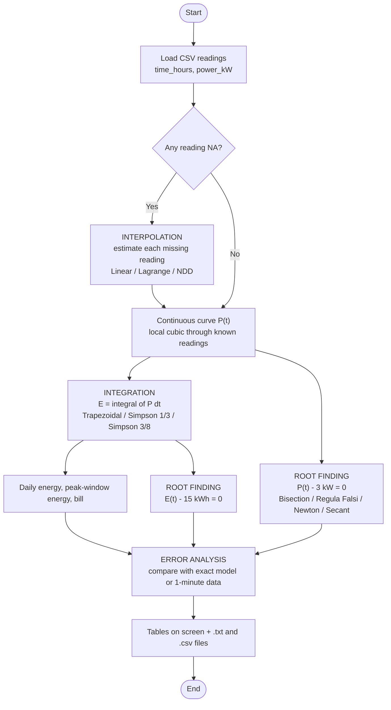

## 2. Main program (menu)

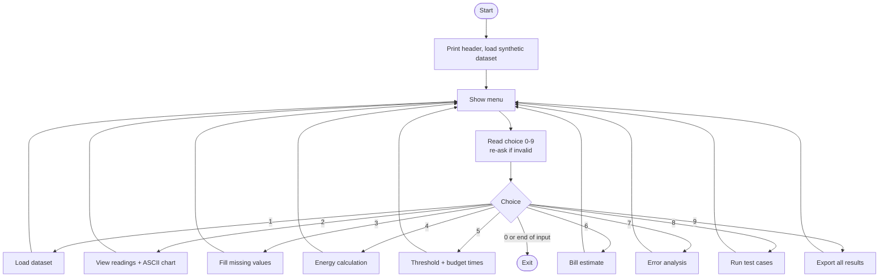

---

## 3. Interpolation

### 3.1 Finding the interval: `find_interval()`
Start at i = 0 and move right while x[i+1] < t. The result is i such that x[i] ≤ t ≤ x[i+1].

### 3.2 Linear interpolation: `interp_linear()`

**Formula:** P(t) = y[i] + (y[i+1] − y[i]) · (t − x[i]) / (x[i+1] − x[i])

**Error:** at most (h²/8)·max|P''|, so the method is order h².

**Algorithm:**
1. i ← find_interval(x, n, t)
2. Return y[i] + (y[i+1] − y[i])(t − x[i]) / (x[i+1] − x[i])

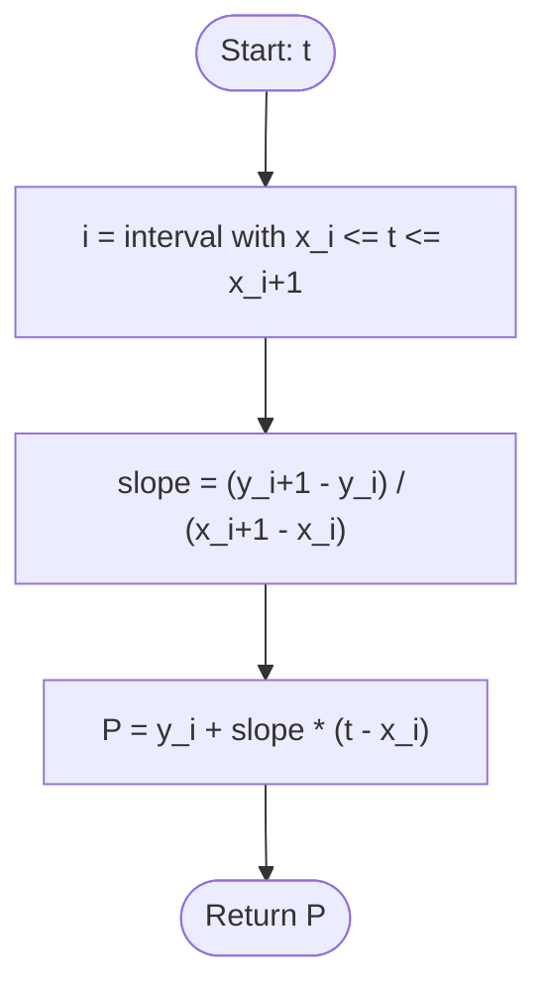

### 3.3 Choosing the 4 points: `local_stencil()`

**Idea:** use two known readings on each side of t. Near the ends the 4 points are shifted inward.

1. s ← find_interval(x, n, t) − 1
2. If s < 0, set s ← 0
3. If s > n − 4, set s ← n − 4
4. The cubic uses x[s], x[s+1], x[s+2], x[s+3]

The 4 points are chosen per interval, so the curves on both sides of a reading pass through that reading. This makes
the whole curve continuous.

### 3.4 Lagrange local cubic: `interp_lagrange_local()` → `lagrange_poly()`

**Formula:** P(t) = Σᵢ yᵢ·Lᵢ(t), where Lᵢ(t) = Π over j ≠ i of (t − xⱼ)/(xᵢ − xⱼ)

Lᵢ equals 1 at xᵢ and 0 at every other xⱼ, so P passes through every point.

**Algorithm:**
1. s ← local_stencil(x, n, t)
2. sum ← 0
3. For i = 0 to 3:
   1. L ← 1
   2. For j = 0 to 3 with j ≠ i: L ← L·(t − x[s+j])/(x[s+i] − x[s+j])
   3. sum ← sum + y[s+i]·L
4. Return sum

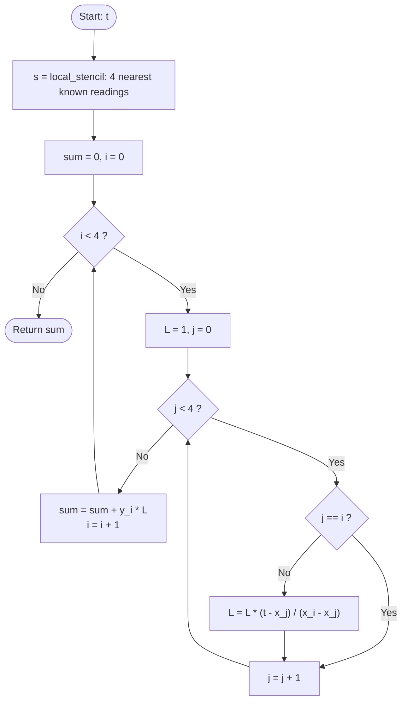

### 3.5 Newton Divided Difference local cubic: `interp_ndd_local()`

**Divided-difference table** (`ndd_build_table()`):
- f[xᵢ] = yᵢ
- f[xᵢ, …, xᵢ₊ⱼ] = (f[xᵢ₊₁, …, xᵢ₊ⱼ] − f[xᵢ, …, xᵢ₊ⱼ₋₁]) / (xᵢ₊ⱼ − xᵢ)

The table is stored as `table[i][j]`. The top row `table[0][0..3]` holds the Newton coefficients c₀ … c₃.

**Newton form** (`ndd_eval()`), evaluated by nested multiplication (Horner's rule):

P(t) = c₀ + c₁(t−x₀) + c₂(t−x₀)(t−x₁) + c₃(t−x₀)(t−x₁)(t−x₂)
     = ((c₃(t−x₂) + c₂)(t−x₁) + c₁)(t−x₀) + c₀

**Algorithm:**
1. s ← local_stencil(x, n, t)
2. For i = 0 to 3: table[i][0] ← y[s+i]
3. For j = 1 to 3, and for i = 0 to 3 − j:
   table[i][j] ← (table[i+1][j−1] − table[i][j−1]) / (x[s+i+j] − x[s+i])
4. result ← table[0][3]
5. For j = 2 down to 0: result ← result·(t − x[s+j]) + table[0][j]
6. Return result

**Correctness check:** Lagrange and NDD build the *same* unique cubic through the same 4 points, so their values must
agree to rounding error (about 10⁻¹⁶). The program prints this check every time.

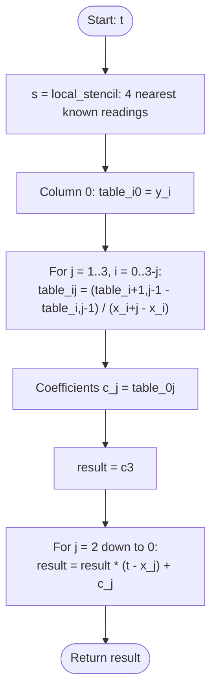

### 3.6 Global Lagrange (demonstration): `interp_lagrange_global()`
This is the same Lagrange formula applied to **all** n known readings at once, giving a polynomial of degree n − 1 = 19.
Between equally spaced points, high-degree polynomials oscillate strongly near the ends of the range
(**Runge's phenomenon**). The program shows a curve error of 24 kW on a load that never exceeds 3.6 kW.

### 3.7 Filling the gaps: `fill_missing()`
For each reading i: if it is missing, out[i] ← interpolate(t[i]) using only the known readings. Otherwise
out[i] ← p[i].

### 3.8 Leave-one-out test (error analysis)
For each inner known reading j:
1. Remove reading j.
2. Predict its value from the other readings.
3. Record the error (prediction − actual).

Then report MAE = mean|e|, RMSE = √(mean e²) and the largest |e|.

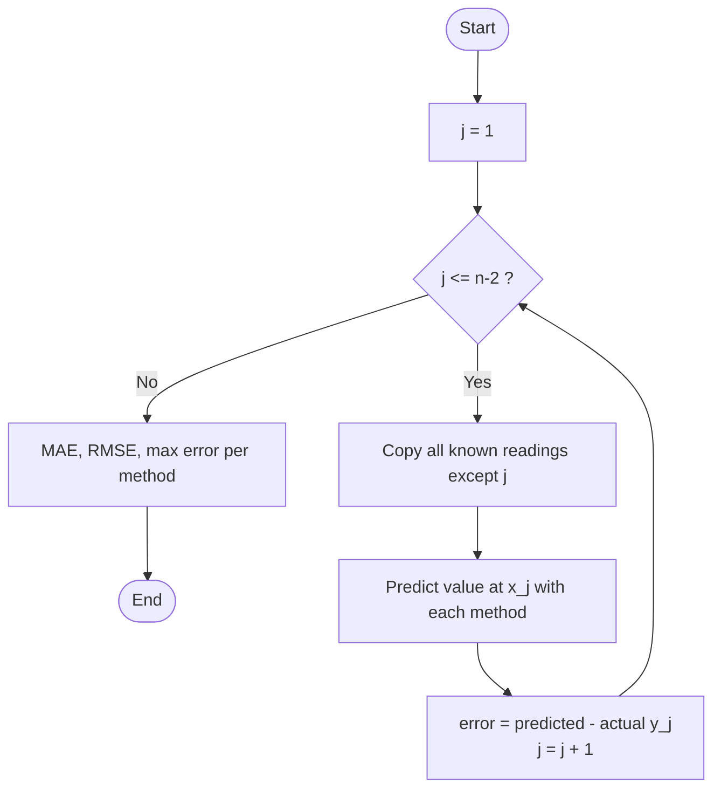

---

## 4. Integration (energy = area under the power curve)

All three rules take readings y₀ … yₘ at equal spacing h, so there are m intervals.

### 4.1 Composite trapezoidal rule: `trapezoidal()`

**Formula:** I = Σ ½(yᵢ + yᵢ₊₁)(xᵢ₊₁ − xᵢ). With equal spacing this becomes h/2·[y₀ + 2(y₁ + … + yₘ₋₁) + yₘ].

**Error:** −(b−a)h²/12·P''(ξ), so the method is **order 2**. The program adds up each trapezoid separately, so it also
works when the spacing varies.

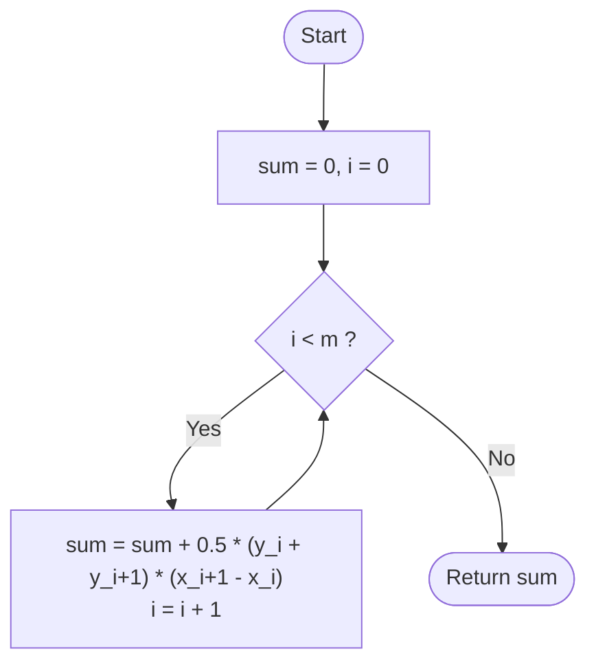

### 4.2 Composite Simpson's 1/3 rule: `simpson_13()`

**Formula:** I = h/3·[y₀ + 4(y₁ + y₃ + …) + 2(y₂ + y₄ + …) + yₘ]. This needs **m even**.

**Error:** −(b−a)h⁴/180·P⁽⁴⁾(ξ), so the method is **order 4**. It is exact for cubics.

**Fallback:** if m is odd, Simpson is applied to the first m − 1 intervals and the trapezoidal rule to the last one,
and a warning flag is set.

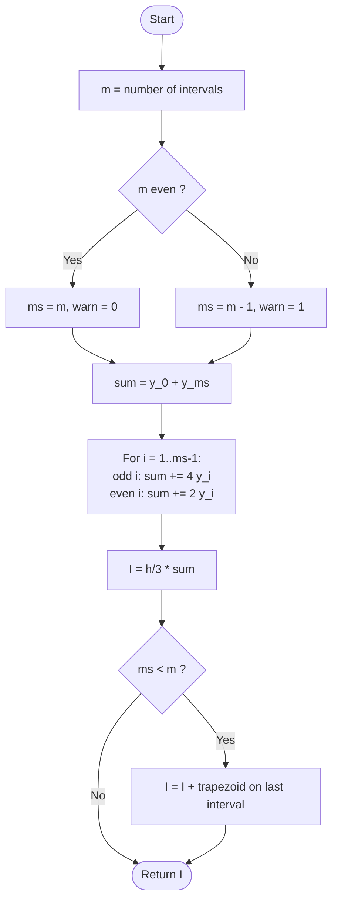

### 4.3 Composite Simpson's 3/8 rule: `simpson_38()`

**Formula:** I = 3h/8·[y₀ + 3y₁ + 3y₂ + 2y₃ + 3y₄ + 3y₅ + 2y₆ + … + yₘ]. This needs **m a multiple of 3**.

**Error:** −(b−a)h⁴/80·P⁽⁴⁾(ξ), so the method is **order 4**.

**Fallback:** 3/8 is applied to the largest multiple of 3 intervals, and the trapezoidal rule to the remaining 1 or 2.

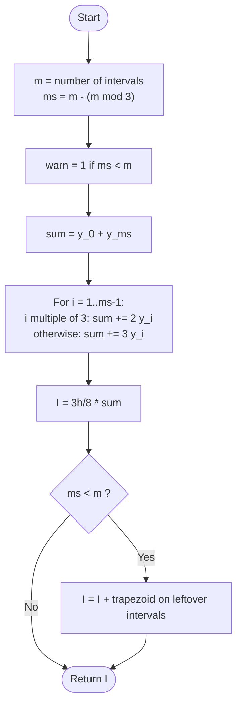

### 4.4 Energy up to time t on the curve: `curve_energy_upto()`
This is needed for the energy-budget root. The local cubic is a single cubic on each interval [xᵢ, xᵢ₊₁], and
Simpson's 1/3 rule is exact for cubics. So E(t) is the sum of (hi − lo)/6·[P(lo) + 4P(mid) + P(hi)] over each interval
up to t, where the last interval is cut at t. This gives the **exact** integral of the model curve.

### 4.5 Observed order of convergence
Integrate with h and with h/2. Then p = log₂(|E(h)| / |E(h/2)|), where E is the error. Theory predicts p = 2 for the
trapezoidal rule and p = 4 for both Simpson rules.

---

## 5. Root finding

We solve f(t) = 0 with:
- f(t) = P(t) − 3 kW (when the load crosses the limit), or
- f(t) = E(t) − 15 kWh (when the energy budget is used up).

**Stopping rule** for all four methods: stop when the step |xₖ − xₖ₋₁| (the half-width for bisection) is below 10⁻⁶ h,
or when f is exactly 0, or after 100 iterations.

### 5.1 Finding brackets: `scan_brackets()`
1. Evaluate f every 0.25 h (15 min) from the first to the last reading.
2. Every sign change between two neighbouring points gives a bracket [a, b] that contains a root.
3. If f is exactly 0 at a check point, record [x, x]: that point is itself a root.

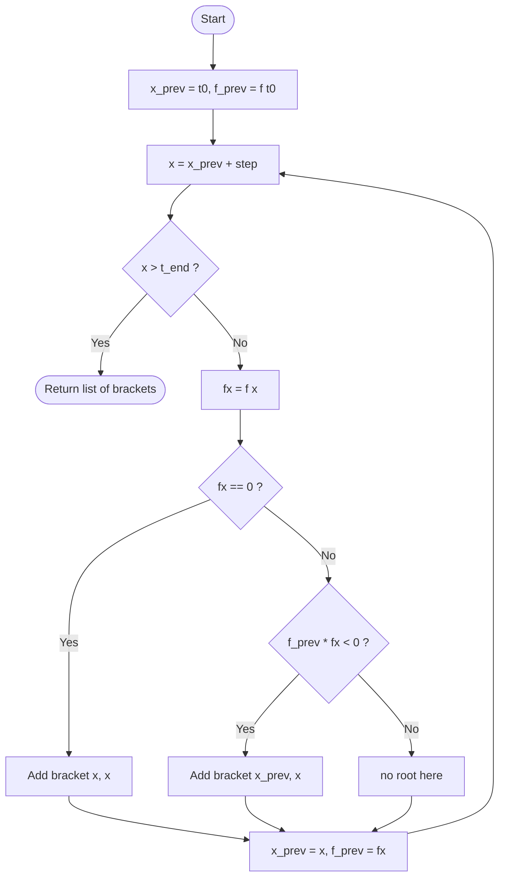

### 5.2 Bisection: `bisection()`

**Idea:** halve the bracket each time and keep the half where the sign changes.

**Convergence:** always converges. The error bound halves every step: order 1, error ratio ½.
Iterations needed ≈ log₂((b − a)/tol). For a 0.25 h bracket that is 18.

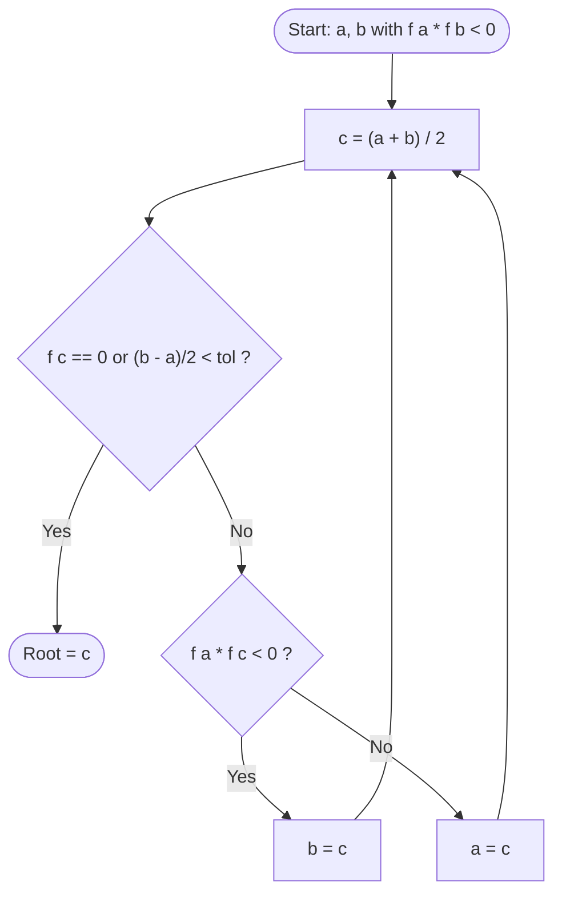

### 5.3 Regula Falsi (false position): `regula_falsi()`

**Idea:** join (a, f(a)) and (b, f(b)) with a straight line and take the point where it crosses zero.

**Formula:** c = b − f(b)(b − a) / (f(b) − f(a))

**Convergence:** always converges because the root stays bracketed. The order is 1, but it is usually much faster than
bisection. One endpoint often stays fixed, which keeps it linear.

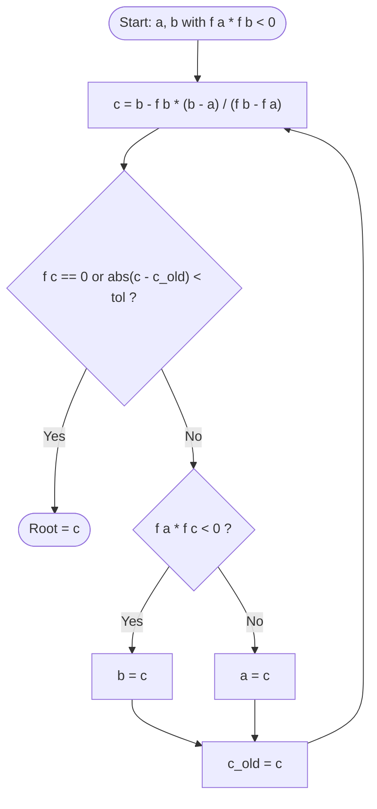

### 5.4 Newton-Raphson: `newton_raphson()`

**Idea:** follow the tangent line down to zero.

**Formula:** xₖ₊₁ = xₖ − f(xₖ)/f'(xₖ)

**Slope:** central difference, f'(x) ≈ [f(x+δ) − f(x−δ)]/(2δ) with δ = 10⁻⁵ h (`central_diff()`). Its error is about
δ², which is far below the tolerance.

**Start:** x₀ = middle of the bracket.

**Convergence:** order 2 near the root, so the number of correct digits roughly doubles each step. It is not guaranteed:
if an iterate leaves the bracket, the program reports "FAILED (left bracket)".

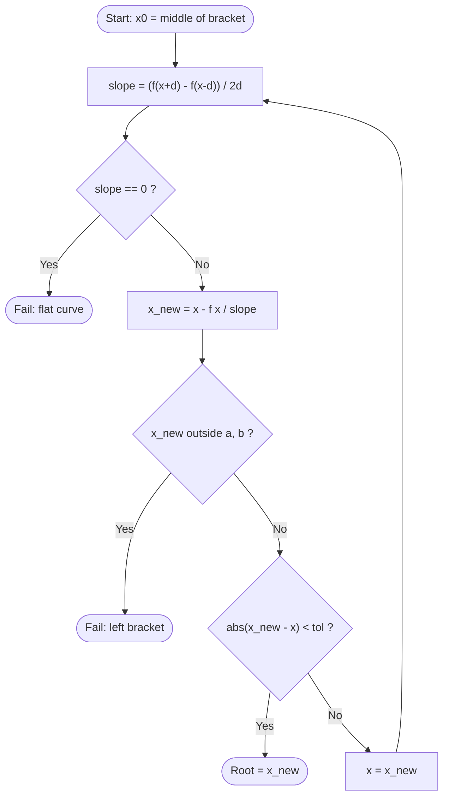

### 5.5 Secant: `secant()`

**Idea:** like Newton, but the slope comes from the last two iterates, so no derivative is needed.

**Formula:** xₖ₊₁ = xₖ − f(xₖ)(xₖ − xₖ₋₁) / (f(xₖ) − f(xₖ₋₁))

**Start:** x₀ = a, x₁ = b.

**Convergence:** order (1 + √5)/2 ≈ 1.618. Like Newton, it is not guaranteed.

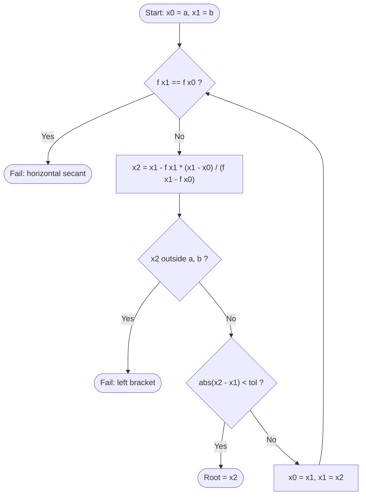

### 5.6 Error measures for root finding
- **Solver error** = |root − x*|, where x* is bisection run to 10⁻¹³ on the **same** curve. This measures how well the method solved the equation it was given.
- **Model error** = root − true crossing time. This measures how well the curve, built from hourly readings, matches reality.
- **Observed order** p = ln(eₖ₊₁/eₖ) / ln(eₖ/eₖ₋₁), using the last three errors above 10⁻¹² (the starting value counts as e₀).

### 5.7 Threshold analysis: `threshold_core()`

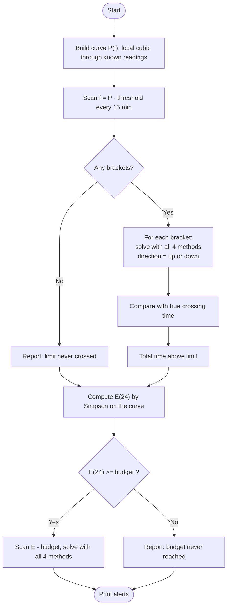

---

## 6. Web front-end data flow (optional part)

The web page contains no numerical methods. The numbers always come from the C program, through one of two paths.

**Live mode** (`python web/serve.py`): each input change runs the C program once.

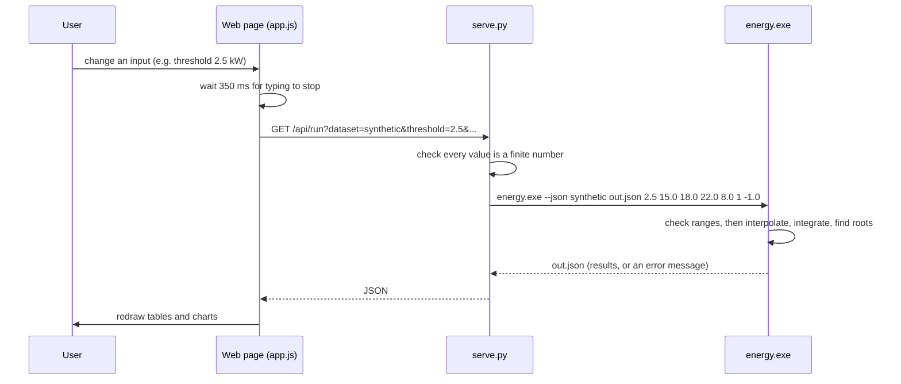

**Offline mode** (opening `web/index.html` directly from disk):

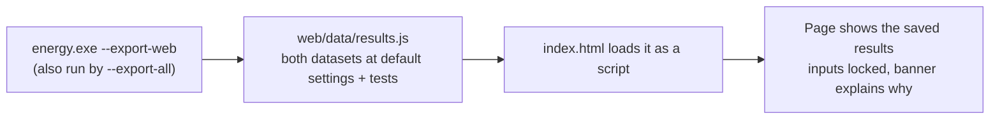

At start-up the page asks `/api/ping`. If the server answers, the page uses live mode; otherwise it uses offline mode.
