# Report Content: Smart Energy Consumption Prediction & Analysis System

> **How to use this file.** This is the full text for the final report, section by section. Copy each section into
> the report template. Every number comes from the program's own output files in `output/` (paths are given next to
> the tables). Items in `[SQUARE BRACKETS]` still need to be filled in. The checklist at the end lists every
> screenshot and figure to insert.

---

## Cover Page

**DELHI TECHNICAL CAMPUS, GREATER NOIDA**
(Affiliated to Guru Gobind Singh Indraprastha University, Delhi)

**Computational Methods Lab (ES-251)**
Project-Based Learning, Session 2026-27 (Odd Semester)

# SMART ENERGY CONSUMPTION PREDICTION & ANALYSIS SYSTEM
*Filling missing smart-meter readings, computing energy and bills, and finding threshold-crossing times with
interpolation, numerical integration and root finding in C*

**Branch / Section / Semester:** [BRANCH / SECTION / SEMESTER]

**Submitted by:**

| S. No. | Name | Enrollment No. |
|---|---|---|
| 1 | Vaibhav (Team Leader) | 01118015625 |
| 2 | Aksh Rastogi | 02518015625 |
| 3 | Akshay Kumar | 00618015625 |
| 4 | Apurva Kr. Yadav | 02418015625 |
| 5 | Vaibhav Sharma | 00518015625 |

**Under the guidance of:** [GUIDE NAME], [DESIGNATION], [DEPARTMENT]

**Date of submission:** [DATE]

---

## Table of Contents

| No. | Section | Page |
|---|---|---|
| | Abstract | [ ] |
| 1 | Project Title and Team Members | [ ] |
| 2 | Problem Statement | [ ] |
| 3 | Objectives | [ ] |
| 4 | Numerical Methods Used and Their Purpose | [ ] |
| 5 | Algorithm / Flowchart | [ ] |
| 6 | C Implementation | [ ] |
| 7 | Input Dataset / Test Cases | [ ] |
| 8 | Results and Sample Output | [ ] |
| 9 | Method Comparison and Error Analysis | [ ] |
| 10 | Discussion and Limitations | [ ] |
| 11 | Conclusion and Possible Future Enhancements | [ ] |
| | References | [ ] |
| | Appendix: Screenshot and Figure Checklist | [ ] |

---

## Abstract

Smart electricity meters record a household's power demand at fixed times, but some readings never reach the
electricity company because of network drops, power cuts or meter faults. This project builds a menu-driven C program
that answers three practical questions from one day of meter readings:

1. What were the missing readings? Answered by **interpolation**: Linear, Lagrange and Newton Divided Difference
   (local cubics), plus a global polynomial that shows Runge's phenomenon.
2. How much energy was used, and what is the bill? Answered by **numerical integration**: the Trapezoidal,
   Simpson 1/3 and Simpson 3/8 rules.
3. When did the load cross the 3 kW limit, and when was the 15 kWh daily budget used up? Answered by
   **root finding**: Bisection, Regula Falsi, Newton-Raphson and Secant.

The three methods form one chain: interpolation builds a continuous power curve, integration turns it into energy, and
root finding solves for the alert times on the same curve.

Every method is checked against data with known true answers. The program uses:
- a synthetic Delhi summer-day model, with exact energy from the error function;
- a real household day from the UCI *Individual Household Electric Power Consumption* dataset, with 1-minute
  reference data.

**Results on the synthetic day:**
- The local cubic fills the five lost readings with a largest error of 0.0702 kW.
- The full-day energy is within 0.15–0.33 % of the exact 30.6882 kWh.
- The observed convergence orders are 2.00 (Trapezoidal), 4.01 (Simpson 1/3) and 4.03 (Simpson 3/8), matching theory.
- At a tolerance of 10⁻⁶ h, Newton-Raphson needs 3 iterations and Bisection 18.

**The most important finding:** the root finders solve their equations to within 10⁻⁶ h (about 3 ms), but the alert
times are wrong by up to 2.59 min (synthetic) and 76.42 min (real). Accuracy is limited by how often the meter reads,
not by the choice of numerical method.

All 21 automated test cases pass. An optional web dashboard shows the C program's results as interactive charts.

---

## 1. Project Title and Team Members

**Title:** Smart Energy Consumption Prediction & Analysis System

**Course:** Computational Methods Lab (ES-251), Project-Based Learning, Delhi Technical Campus, Greater Noida,
Session 2026-27 (Odd Semester)

**Branch / Section / Semester:** [BRANCH / SECTION / SEMESTER]

| S. No. | Name | Enrollment No. | Role |
|---|---|---|---|
| 1 | Vaibhav | 01118015625 | Team Leader |
| 2 | Aksh Rastogi | 02518015625 | [ROLE] |
| 3 | Akshay Kumar | 00618015625 | [ROLE] |
| 4 | Apurva Kr. Yadav | 02418015625 | [ROLE] |
| 5 | Vaibhav Sharma | 00518015625 | [ROLE] |

**Guide:** [GUIDE NAME]

**What was built:**
- **Core project, in C:** all numerical methods, the error analysis, the 21 test cases and the menu-driven program are
  written in C99 (`src/`). This is the part the course requires.
- **Showcase layer:** a web dashboard (`web/`) that runs the same C program and only displays its results.
- **Optional helpers, in Python:** a local web server, the graph-plotting script and a one-time data-extraction script.

---

## 2. Problem Statement

A smart meter records a household's power demand P (in kW) every hour, and a day has 25 readings from 00:00 to 24:00.
Five of these readings are lost (04:00, 09:00, 13:00, 14:00 and 19:00). The task is to design and implement, in C:

1. A way to **estimate the missing readings** and build a continuous power curve P(t).
2. A way to **compute the energy used**, E = ∫P(t) dt in kWh, over the whole day and over the evening peak window
   (18:00–22:00), and from it an **electricity bill** at a flat rate (default Rs 8.00/kWh).
3. A way to find **the exact times** when:
   - the load crosses the sanctioned-load limit of **3 kW**, by solving P(t) − 3 = 0;
   - the day's cumulative energy reaches a **15 kWh budget**, by solving E(t) − 15 = 0.
4. An **error analysis** that compares the methods against known true answers, so that the report can say which
   method is better, and by how much.

The two root-finding problems behave differently:
- P(t) − 3 = 0 can have several roots, because the load rises above the limit and later falls back.
- E(t) − 15 = 0 has exactly one root, because cumulative energy only increases.

---

## 3. Objectives

1. Implement in C (C99, modular, menu-driven) three interpolation methods (Linear, Lagrange local cubic and Newton
   Divided Difference local cubic), three integration rules (Trapezoidal, Simpson 1/3 and Simpson 3/8) and four
   root-finding methods (Bisection, Regula Falsi, Newton-Raphson and Secant).
2. Chain the methods: fill the gaps, then integrate the filled data, then find the crossing times on the
   interpolated curve.
3. Verify every method on test functions with hand-computed answers, and on a synthetic household day whose exact
   power, energy and crossing times are known.
4. Test the methods on a real household day (UCI dataset) against 1-minute reference data.
5. Compare the methods by error, iterations and observed order of convergence. Separate the error of the
   **method** from the error of the **data**.
6. Produce screenshot-ready tables, CSV files and graphs for the report, and 21 automated PASS/FAIL test cases.

---

## 4. Numerical Methods Used and Their Purpose

Notation:
- t = time in hours, P = power in kW, E = energy in kWh
- (xᵢ, yᵢ) = known readings
- h = spacing between readings (1 hour here)

### 4.1 Interpolation: estimating the missing readings

| Method | Formula | Error order | Requirements | Why chosen |
|---|---|---|---|---|
| **Linear** | P(t) = yᵢ + (yᵢ₊₁ − yᵢ)(t − xᵢ)/(xᵢ₊₁ − xᵢ) | Error ≤ (h²/8)·max\|P''\|, so O(h²) | 2 neighbouring points | Simplest baseline. It never overshoots, which turns out to matter on spiky real data |
| **Lagrange (local cubic)** | P(t) = Σᵢ yᵢ Lᵢ(t), where Lᵢ(t) = Πⱼ≠ᵢ (t − xⱼ)/(xᵢ − xⱼ), on the 4 nearest known points | Error = P⁽⁴⁾(ξ)/4!·Π(t − xᵢ), so O(h⁴) | 4 distinct points; points may be unequally spaced | Higher accuracy on smooth curves. Works with unequal spacing, which is needed when two readings in a row are lost (13:00, 14:00) |
| **Newton Divided Difference (local cubic)** | P(t) = c₀ + c₁(t − x₀) + c₂(t − x₀)(t − x₁) + c₃(t − x₀)(t − x₁)(t − x₂), where cⱼ = f[x₀, …, xⱼ] | Same cubic as Lagrange, so the same O(h⁴) error | Same 4 points | The divided-difference table can be printed and checked by hand. Evaluation by nested multiplication is cheap. **Correctness check:** it must equal Lagrange to rounding error |
| **Global Lagrange (Runge demonstration)** | One polynomial of degree 19 through all 20 known points | Error grows near the ends for equally spaced points (Runge's phenomenon) | All points | Shows *why* a local cubic is used instead of one high-degree polynomial |

**Local stencil.** For t in [xᵢ, xᵢ₊₁], the cubic uses xᵢ₋₁, xᵢ, xᵢ₊₁ and xᵢ₊₂, shifted inward at the ends of the day.
The four points are chosen per interval, so the curves on both sides of a reading pass through that reading. The whole
curve is therefore continuous.

### 4.2 Integration: computing the energy

All three rules use readings y₀ … yₘ at equal spacing h, so there are m intervals.

| Rule | Formula | Error term | Order | Requirements | Why chosen |
|---|---|---|---|---|---|
| **Trapezoidal** | I = (h/2)[y₀ + 2(y₁ + … + yₘ₋₁) + yₘ] | −(b − a)h²P''(ξ)/12 | 2 | Any number of intervals; the program adds trapezoids one by one, so spacing may vary | Simplest rule. Exact for straight lines, and robust on spiky data |
| **Simpson 1/3** | I = (h/3)[y₀ + 4(y₁ + y₃ + …) + 2(y₂ + y₄ + …) + yₘ] | −(b − a)h⁴P⁽⁴⁾(ξ)/180 | 4 | Equal spacing, m even | Exact for cubics. Much more accurate on smooth data |
| **Simpson 3/8** | I = (3h/8)[y₀ + 3y₁ + 3y₂ + 2y₃ + 3y₄ + 3y₅ + 2y₆ + … + yₘ] | −(b − a)h⁴P⁽⁴⁾(ξ)/80 | 4 | Equal spacing, m a multiple of 3 | A second order-4 rule to compare with Simpson 1/3. It handles interval counts that are multiples of 3 but odd (3, 9, …), where Simpson 1/3 needs a fallback |

**Fallback.** If the interval count does not suit a Simpson rule, the rule is applied to as many intervals as possible
and the Trapezoidal rule to the 1 or 2 leftover intervals. A warning flag is shown (marked `*` in the tables).

**Energy up to time t, E(t)**, is needed for the budget root. On each interval the local cubic is a single cubic
polynomial, and Simpson's rule on one interval, (h/6)[P(lo) + 4P(mid) + P(hi)], is exact for cubics. So E(t) is the
exact integral of the interpolated curve.

### 4.3 Root finding: finding the alert times

The program solves f(t) = 0 for two functions:
- f(t) = P(t) − 3 kW, for the threshold crossings;
- f(t) = E(t) − 15 kWh, for the budget time.

All methods stop when the step |xₖ − xₖ₋₁| is below **10⁻⁶ h** (about 3.6 ms), or when f is exactly 0, or after
100 iterations.

**Brackets.** Before solving, f is checked every 0.25 h (15 min). Each sign change gives a bracket [a, b] that contains
a root.

| Method | Formula | Order | Requirements | Why chosen |
|---|---|---|---|---|
| **Bisection** | c = (a + b)/2; keep the half where the sign changes | 1 (the error bound halves each step); about log₂((b − a)/tol) iterations, which is 18 for a 0.25 h bracket | f(a)·f(b) < 0 | Always converges. A safe baseline |
| **Regula Falsi** | c = b − f(b)(b − a)/(f(b) − f(a)) | 1 (one end often stays fixed) | f(a)·f(b) < 0 | Bracketed and safe, but usually much faster than bisection |
| **Newton-Raphson** | xₖ₊₁ = xₖ − f(xₖ)/f'(xₖ), with f'(x) ≈ [f(x + δ) − f(x − δ)]/(2δ) and δ = 10⁻⁵ h | 2 | A good start (the middle of the bracket); a non-zero slope | Fastest. The slope comes from a central difference because the curve is only known numerically. The program flags a failure if an iterate leaves the bracket |
| **Secant** | xₖ₊₁ = xₖ − f(xₖ)(xₖ − xₖ₋₁)/(f(xₖ) − f(xₖ₋₁)) | (1 + √5)/2 ≈ 1.618 | Two starting values (a and b) | Nearly as fast as Newton, with no derivative needed |

**Error measures for root finding.**
- **Solver error** = |root − x\*|, where x\* is bisection run to 10⁻¹³ on the *same* curve. This measures how well the
  method solved its equation.
- **Model error** = root − true crossing time. This measures how well the curve built from hourly readings matches
  reality.
- **Observed order** p = ln(eₖ₊₁/eₖ)/ln(eₖ/eₖ₋₁), from the last three errors above 10⁻¹².

---

## 5. Algorithm / Flowchart

> The flowcharts are written in Mermaid. They render on GitHub, in VS Code and at https://mermaid.live, which can
> export each one as PNG or SVG for the report. The function names match the C code in `src/`.

### 5.1 Overall system

**Algorithm:**
1. Load the CSV readings (time in hours, power in kW; `NA` marks a missing reading).
2. Fill each missing reading by interpolation, and build the continuous curve P(t) (local cubic).
3. Integrate: daily energy, peak-window energy and the bill.
4. Root-find on the same curve: P(t) − 3 = 0 (threshold crossings) and E(t) − 15 = 0 (budget time).
5. Compare every result with the known true values. Print the tables and write the `.txt` and `.csv` files.

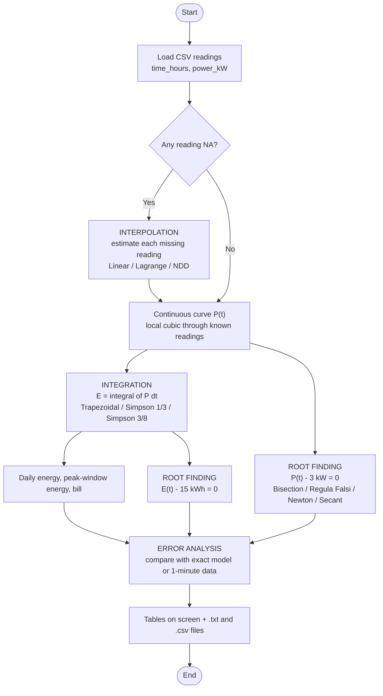

### 5.2 Main program (menu)

**Algorithm:**
1. Print the header and load the synthetic dataset.
2. Show the menu and read a choice from 0 to 9, asking again if the input is invalid.
3. Run the chosen feature and return to the menu. Exit on 0 or at the end of input.

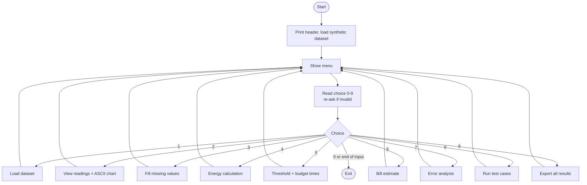

### 5.3 Linear interpolation: `interp_linear()`

**Algorithm:**
1. Find i such that xᵢ ≤ t ≤ xᵢ₊₁.
2. Return yᵢ + (yᵢ₊₁ − yᵢ)(t − xᵢ)/(xᵢ₊₁ − xᵢ).

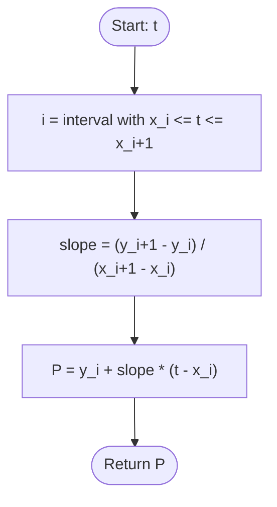

### 5.4 Lagrange local cubic: `interp_lagrange_local()`

**Algorithm:**
1. Set s to the start of the 4 nearest known readings (`local_stencil()`).
2. Set sum = 0.
3. For i = 0 to 3:
   1. Set L = 1.
   2. For each j from 0 to 3 with j ≠ i, set L = L·(t − x[s+j])/(x[s+i] − x[s+j]).
   3. Set sum = sum + y[s+i]·L.
4. Return sum.

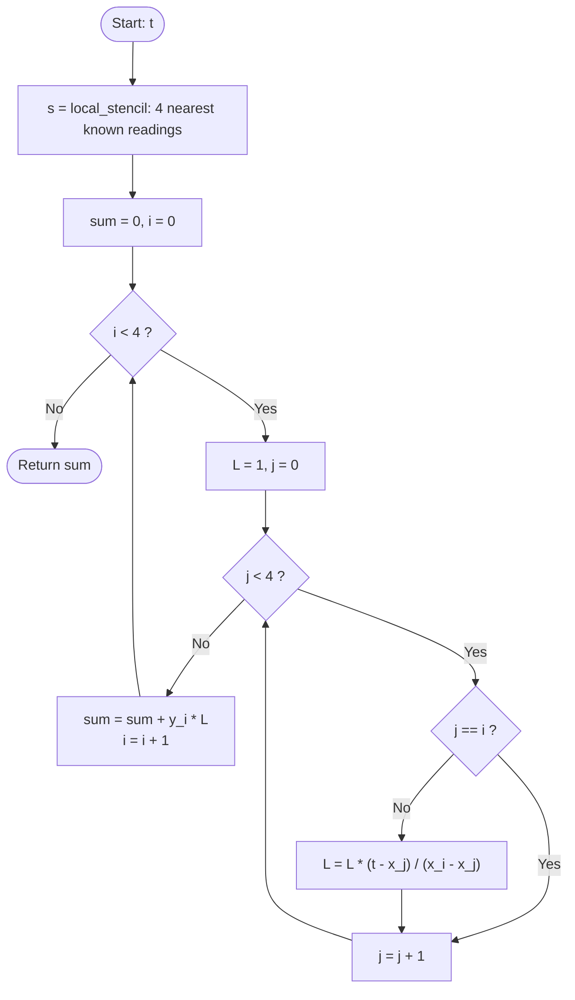

### 5.5 Newton Divided Difference local cubic: `interp_ndd_local()`

**Algorithm:**
1. Set s using `local_stencil()`.
2. Fill the first column: table[i][0] = y[s+i].
3. For j = 1 to 3, and i = 0 to 3 − j: table[i][j] = (table[i+1][j−1] − table[i][j−1])/(x[s+i+j] − x[s+i]).
4. The top row holds the coefficients c₀ … c₃. Set result = c₃.
5. For j = 2 down to 0: result = result·(t − x[s+j]) + cⱼ (nested multiplication).
6. Return result.

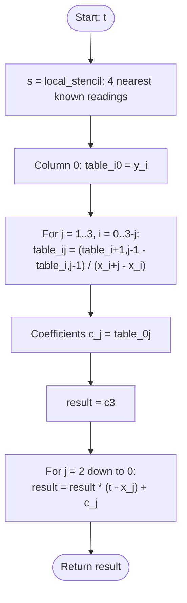

### 5.6 Leave-one-out test (interpolation error analysis)

**Algorithm:** for each inner known reading j:
1. Hide reading j.
2. Predict its value from the other readings with each method.
3. Record the error (prediction − actual).

Finally, report MAE, RMSE and the largest error for each method.

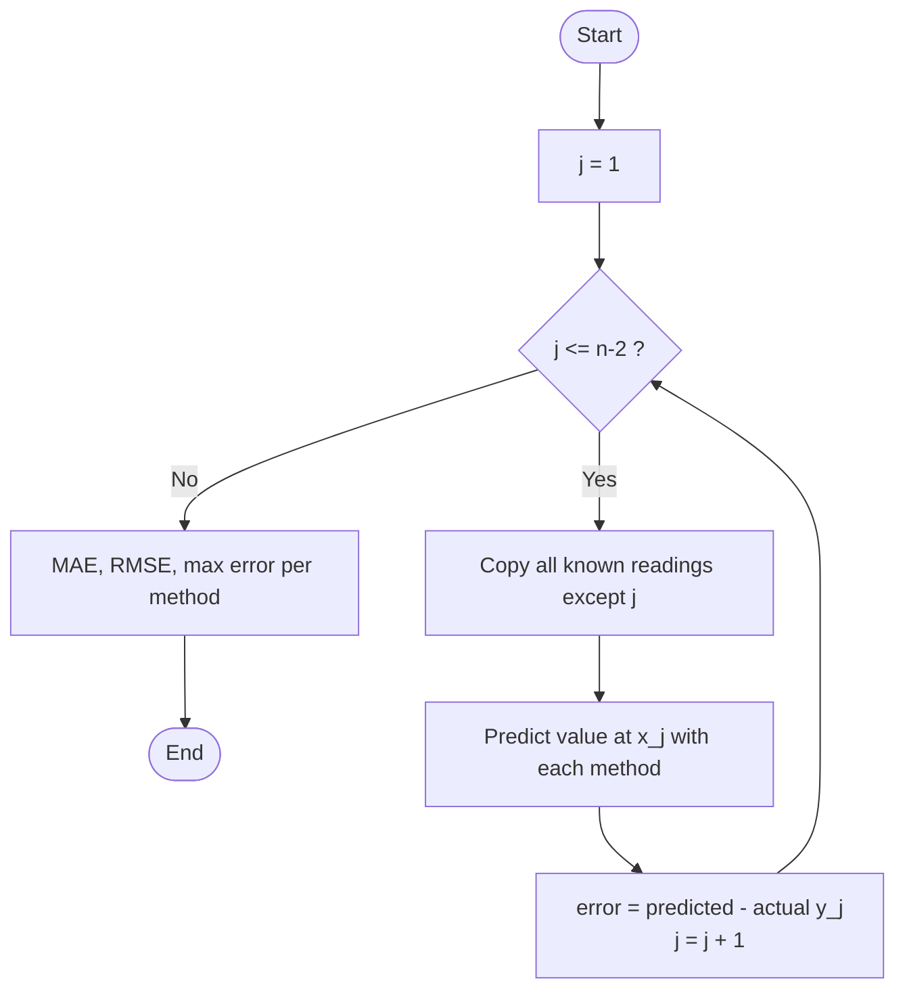

### 5.7 Composite Trapezoidal rule: `trapezoidal()`

**Algorithm:**
1. Set sum = 0.
2. For each interval i, add ½(yᵢ + yᵢ₊₁)(xᵢ₊₁ − xᵢ).
3. Return sum.

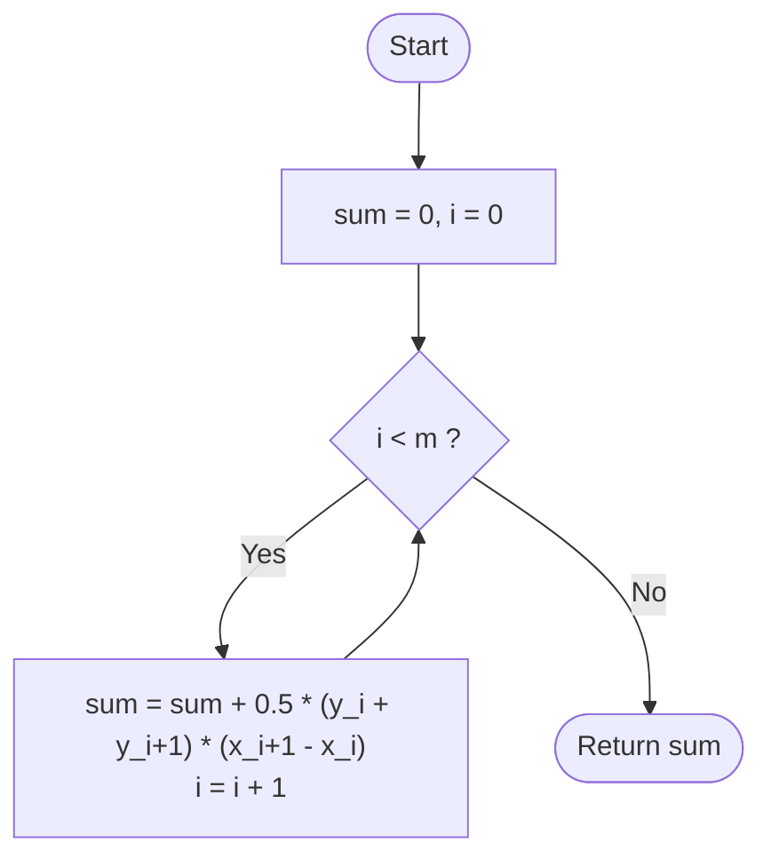

### 5.8 Composite Simpson 1/3 rule: `simpson_13()`

**Algorithm:**
1. Let m be the number of intervals.
2. If m is even, set ms = m. Otherwise set ms = m − 1 and raise the warning flag.
3. sum = y₀ + y_ms + 4·(odd-index values) + 2·(even-index values).
4. I = (h/3)·sum.
5. If ms < m, add the trapezoid on the last interval.

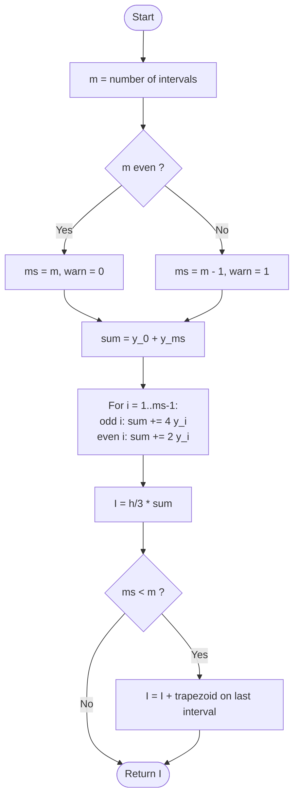

### 5.9 Composite Simpson 3/8 rule: `simpson_38()`

**Algorithm:**
1. Set ms = m − (m mod 3), and raise the warning flag if ms < m.
2. sum = y₀ + y_ms + 2·(every third value) + 3·(all others).
3. I = (3h/8)·sum.
4. Add the trapezoids on the 1 or 2 leftover intervals.

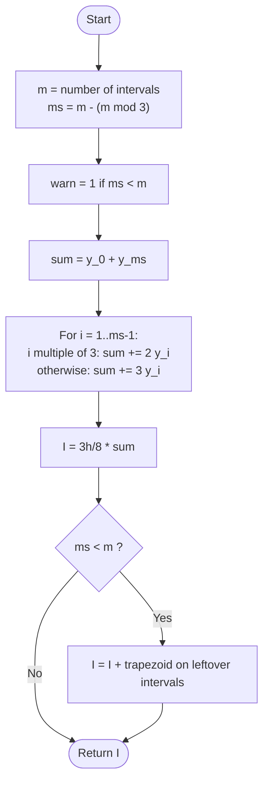

### 5.10 Bracket scan: `scan_brackets()`

**Algorithm:**
1. Evaluate f every 0.25 h from the first reading to the last.
2. Each sign change between neighbouring points gives a bracket [a, b].
3. If f is exactly 0 at a check point, record [x, x].

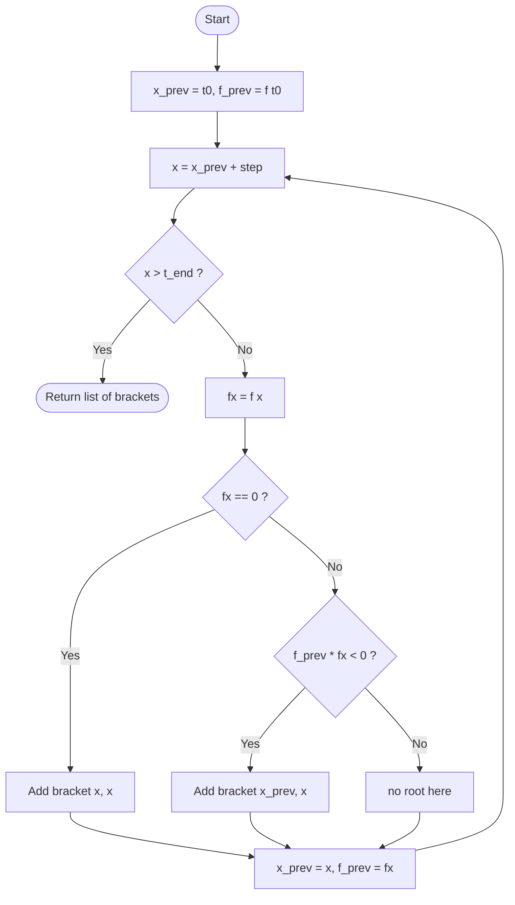

### 5.11 Bisection: `bisection()`

**Algorithm:**
1. Start with a and b, where f(a)·f(b) < 0.
2. Set c = (a + b)/2.
3. Stop if f(c) = 0 or (b − a)/2 < tol.
4. If f(a)·f(c) < 0, set b = c; otherwise set a = c. Go to step 2.

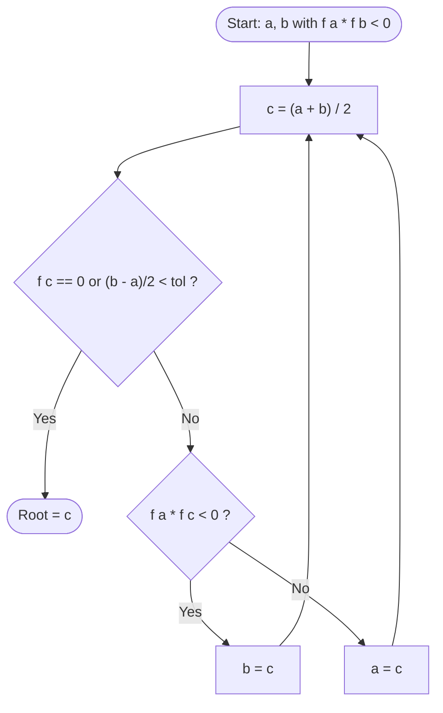

### 5.12 Regula Falsi: `regula_falsi()`

**Algorithm:**
1. Start with a and b, where f(a)·f(b) < 0.
2. Set c = b − f(b)(b − a)/(f(b) − f(a)).
3. Stop if f(c) = 0 or |c − c_old| < tol.
4. Replace the endpoint whose f has the same sign as f(c). Go to step 2.

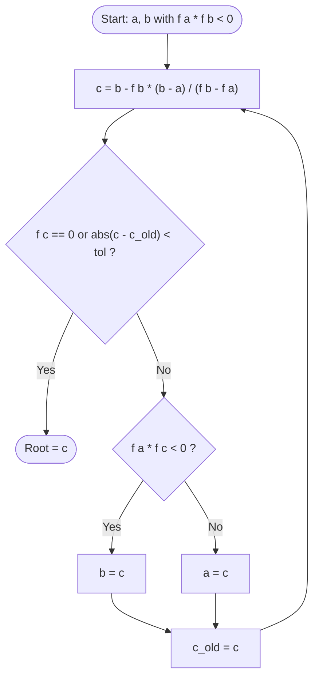

### 5.13 Newton-Raphson: `newton_raphson()`

**Algorithm:**
1. Start at x₀, the middle of the bracket.
2. Compute the slope by central difference: [f(x + δ) − f(x − δ)]/(2δ), with δ = 10⁻⁵ h.
3. If the slope is 0, stop and report failure.
4. Set x_new = x − f(x)/slope.
5. If x_new is outside [a, b], stop and report "left bracket".
6. If |x_new − x| < tol, x_new is the root. Otherwise set x = x_new and go to step 2.

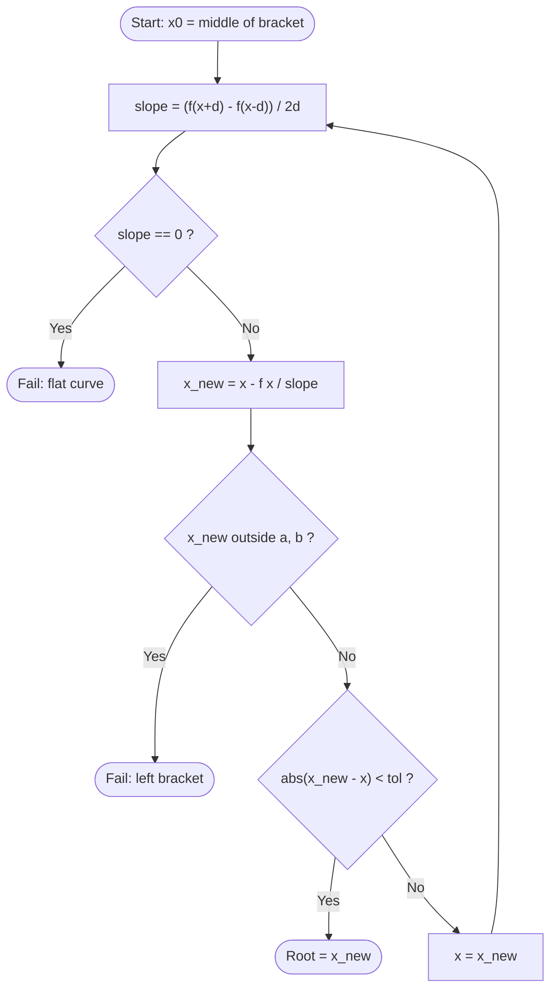

### 5.14 Secant: `secant()`

**Algorithm:**
1. Start with x₀ = a and x₁ = b.
2. If f(x₁) = f(x₀), stop and report failure.
3. Set x₂ = x₁ − f(x₁)(x₁ − x₀)/(f(x₁) − f(x₀)).
4. If x₂ is outside [a, b], stop and report "left bracket".
5. If |x₂ − x₁| < tol, x₂ is the root. Otherwise shift (x₀, x₁) ← (x₁, x₂) and go to step 2.

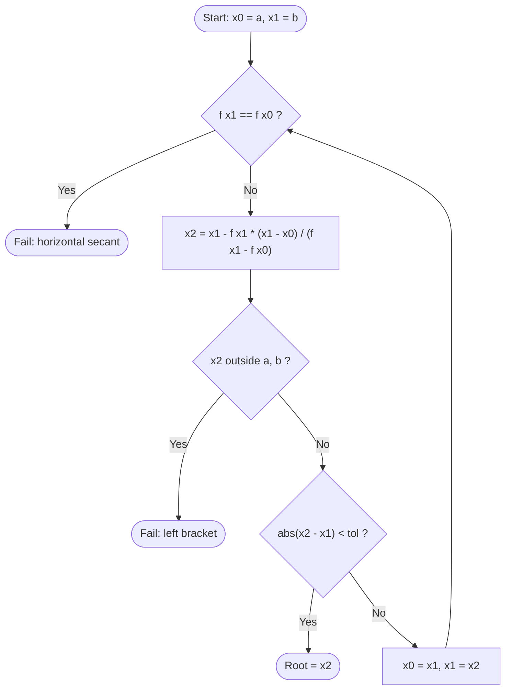

### 5.15 Threshold and budget analysis: `threshold_core()`

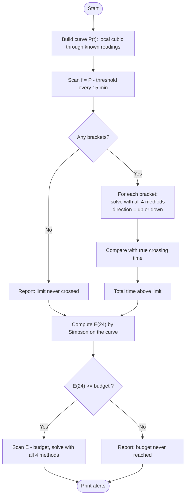

---

## 6. C Implementation

### 6.1 Language and build

- **Language:** C (C99), split into modules. 10 `.c` files and 10 `.h` files, 3,836 lines including comments.
- **Compiler:** GCC (MinGW GCC 6.3.0 on Windows 11 was used for development).
- **Warnings:** the code compiles with **no warnings** under `-std=c99 -Wall -Wextra -pedantic`.
- **Memory:** fixed-size arrays (up to 2000 readings) and no dynamic memory, so there are no memory leaks.
  One day of 1-minute data (1441 values) fits.

**Build and run:**

```
build.bat                         (Windows: compiles all 10 .c files into energy.exe)
gcc -std=c99 -Wall -Wextra -O2 src/*.c -o energy.exe -lm      (same, by hand; Linux/Mac)

energy.exe                        interactive menu
energy.exe --test                 run the 21 test cases (PASS/FAIL table)
energy.exe --export-all           write every result file for both datasets + tests
```

### 6.2 Folder structure

```
CM-PBL-project/
├── src/                 C source code (the core project)
├── data/                synthetic_day.csv, real_day_hourly.csv, real_day_hourly_complete.csv,
│                        real_day_minute.csv, custom_template.csv
├── output/              generated results: synthetic/, real/, figures/, web_screenshots/, test_results.txt
├── docs/                PLAN.md, algorithms.md, data_source.md, viva_notes.md
├── web/                 optional dashboard (HTML/CSS/JS + serve.py)
├── scripts/             optional Python helpers: extract_uci_day.py, plot_results.py
├── build.bat, README.md, LICENSE
```

### 6.3 Modules

| File | Main functions | Purpose |
|---|---|---|
| `main.c` | `main()`, `print_menu()`, `menu_load()`, `menu_fill()`, `menu_analysis()` | Menu loop, input prompts, command-line options |
| `dataset.h` | `Dataset` struct | Readings, missing flags and true values, shared by all modules |
| `data_io.c/.h` | `load_csv()`, `load_reference()`, `load_fine()`, `known_points()`, `make_dir()` | Read and check CSV files; copy out the known readings |
| `load_model.c/.h` | `model_power()`, `model_energy()`, `generate_synthetic_csv()` | Synthetic load model P(t), its exact energy (erf) and the synthetic CSV |
| `interpolation.c/.h` | `interp_linear()`, `local_stencil()`, `lagrange_poly()`, `ndd_build_table()`, `ndd_eval()`, `interp_lagrange_global()`, `fill_missing()` | All interpolation methods |
| `integration.c/.h` | `trapezoidal()`, `simpson_13()`, `simpson_38()`, `is_equally_spaced()`, `integrate_grid()` | All integration rules |
| `root_finding.c/.h` | `bisection()`, `regula_falsi()`, `newton_raphson()`, `secant()`, `central_diff()`, `scan_brackets()`, `estimate_order()` | All root finders, bracket scan and observed order |
| `analysis.c/.h` | `curve_power()`, `curve_energy_upto()`, `f_power()`, `f_energy()`, `threshold_core()`, `solve_event()`, `show_*()`, `sec_*()`, `export_all()` | Connects the methods into the chain; menu features; every error-analysis experiment |
| `report.c/.h` | `rprintf()`, `print_header()`, `fmt_hhmm()`, `ascii_chart()`, `read_int()`, `read_double_default()` | Screen and file output, tables, ASCII chart, safe input |
| `tests.c/.h` | `run_all_tests()`, `test_count()`, `test_row()` | 21 automated test cases |
| `web_export.c/.h` | `write_json()`, `write_tests_json()`, `export_web()` | The same results as JSON, for the web dashboard |

### 6.4 Menu

```
=================== MAIN MENU ===================
 1. Load dataset
 2. View readings and load-curve chart
 3. Fill missing values (interpolation)
 4. Energy calculation (integration)
 5. Threshold and energy-budget analysis (root finding)
 6. Bill estimate (flat Rs/kWh rate)
 7. Error analysis and method comparison
 8. Run test cases
 9. Export all results to output/
 0. Exit
=================================================
```

- **Defaults:** 3 kW threshold, 15 kWh budget, 18:00–22:00 peak window, Rs 8.00/kWh. Press Enter to keep a default.
- **Bad input** (letters, out-of-range numbers, missing files, end of input) is handled without crashing.
- **Datasets** (Menu 1): synthetic day, real UCI day, a custom CSV file, or regenerate the synthetic CSV.

### 6.5 Key code (short excerpts from `src/`)

**Linear interpolation** (`interpolation.c`):

```c
double interp_linear(const double x[], const double y[], int n, double t)
{
    int i = find_interval(x, n, t);
    return y[i] + (y[i + 1] - y[i]) * (t - x[i]) / (x[i + 1] - x[i]);
}
```

**Lagrange form** (`interpolation.c`), called with the 4 nearest points for the local cubic:

```c
double lagrange_poly(const double x[], const double y[], int m, double t)
{
    double sum = 0.0;
    int i, j;
    for (i = 0; i < m; i++) {
        double L = 1.0;
        for (j = 0; j < m; j++)
            if (j != i) L *= (t - x[j]) / (x[i] - x[j]);
        sum += y[i] * L;
    }
    return sum;
}
```

**Newton divided differences**, the table and nested evaluation (`interpolation.c`):

```c
for (j = 1; j < m; j++)
    for (i = 0; i < m - j; i++)
        table[i][j] = (table[i + 1][j - 1] - table[i][j - 1]) / (x[i + j] - x[i]);

double result = table[0][m - 1];                 /* ndd_eval(): nested multiplication */
for (j = m - 2; j >= 0; j--)
    result = result * (t - x[j]) + table[0][j];
```

**Trapezoidal rule** (`integration.c`):

```c
for (i = 0; i < n - 1; i++)
    sum += 0.5 * (y[i] + y[i + 1]) * (x[i + 1] - x[i]);
```

**Simpson 1/3 rule with fallback** (`integration.c`):

```c
int m = n - 1;                          /* number of intervals          */
int ms = (m % 2 == 0) ? m : m - 1;      /* largest even number <= m     */
sum = y[0] + y[ms];
for (i = 1; i < ms; i++)
    sum += (i % 2 == 1 ? 4.0 : 2.0) * y[i];
return h / 3.0 * sum + trap_equal(y, ms, m, h);   /* leftover interval, if any */
```

**Simpson 3/8 rule** (`integration.c`):

```c
int ms = m - m % 3;                     /* largest multiple of 3 <= m   */
sum = y[0] + y[ms];
for (i = 1; i < ms; i++)
    sum += (i % 3 == 0 ? 2.0 : 3.0) * y[i];
return 3.0 * h / 8.0 * sum + trap_equal(y, ms, m, h);
```

**Bisection loop** (`root_finding.c`):

```c
for (k = 0; k < max_iter; k++) {
    double c = 0.5 * (a + b), fc = f(c);
    record(&r, c);
    if (fc == 0.0 || 0.5 * (b - a) < tol) { r.converged = 1; break; }
    if (fa * fc < 0.0) b = c;           /* root in the left half  */
    else { a = c; fa = fc; }            /* root in the right half */
}
```

**Regula Falsi step** (`root_finding.c`):

```c
double c = b - fb * (b - a) / (fb - fa), fc = f(c);
```

**Newton-Raphson with a central-difference slope** (`root_finding.c`):

```c
double central_diff(Func f, double x)
{
    const double d = 1e-5;
    return (f(x + d) - f(x - d)) / (2.0 * d);
}
/* inside newton_raphson(): */
x_new = x - fx / slope;
if (x_new < a || x_new > b) { r.left_bracket = 1; break; }   /* unsafe: report it */
if (fabs(x_new - x) < tol)  { r.converged = 1;    break; }
```

**Secant step** (`root_finding.c`):

```c
x2 = x1 - f1 * (x1 - x0) / (f1 - f0);
```

**Functions handed to the root finders** (`analysis.c`). The energy curve is integrated exactly, piece by piece:

```c
double curve_energy_upto(double t)
{
    double e = 0.0;
    int i;
    for (i = 0; i < g_nk - 1; i++) {
        double lo = g_kx[i], hi = g_kx[i + 1], mid;
        if (lo >= t) break;
        if (hi > t) hi = t;
        mid = 0.5 * (lo + hi);
        e += (hi - lo) / 6.0 * (curve_power(lo) + 4.0 * curve_power(mid) + curve_power(hi));
    }
    return e;
}
double f_power(double t)  { return curve_power(t) - g_threshold; }
double f_energy(double t) { return curve_energy_upto(t) - g_budget; }
```

### 6.6 Web dashboard (showcase layer)

The dashboard presents the C program's results visually for the demonstration. **It contains no numerical methods.**
Every number on it is produced by `energy.exe`.

**Architecture:**

```
Browser (index.html + app.js + Chart.js)
   │  1. user changes an input (e.g. threshold = 2.5 kW)
   ▼
web/serve.py  (Python standard library, local only: 127.0.0.1:8000)
   │  2. checks the inputs, then runs:
   ▼
energy.exe --json synthetic out.json 2.5 15.0 18.0 22.0 8.0 1 -1.0      (the C program)
   │  3. C interpolates, integrates and finds the roots, then writes JSON
   ▼
JSON  ──►  app.js formats tables  ──►  Chart.js draws the charts
```

- **Live mode:** `python web/serve.py`, then open http://localhost:8000. Every input change re-runs the C program.
- **Offline mode:** open `web/index.html` directly. It shows a saved snapshot, `web/data/results.js`, written by
  `energy.exe --export-web`. The inputs are locked.
- **Seven sections:** Overview, Dataset, Fill Missing Values, Energy & Bill, Threshold Alerts, Method Comparison
  & Error Analysis, and Tests.
- **Technology:** HTML, CSS and plain JavaScript, with Chart.js 4.4.1 (bundled locally) and no framework.
- The C side added one module (`web_export.c`) and the command-line options `--json`, `--json-tests` and
  `--export-web`. The dashboard therefore shows exactly the numbers in the terminal tables.

---

## 7. Input Dataset / Test Cases

### 7.1 Dataset 1: synthetic Delhi household (summer day)

**Model** (generated by the program itself, `src/load_model.c`):

```
P(t) = 0.5 + 1.0·g(t; 8.0, 1.0) + 0.8·g(t; 15.0, 2.5) + 3.0·g(t; 20.5, 1.5)    [kW]
g(t; μ, σ) = exp(−(t − μ)² / (2σ²))
```

| Term | Meaning |
|---|---|
| 0.5 kW base | Fridge, fans, standby, always on |
| 1.0 kW bump at 08:00 (σ = 1 h) | Morning: water pump, kettle, iron |
| 0.8 kW bump at 15:00 (σ = 2.5 h) | Afternoon AC |
| 3.0 kW bump at 20:30 (σ = 1.5 h) | Evening peak: AC, lights, TV, cooking |

- **Readings:** the model is evaluated at t = 0, 1, …, 24 h (25 readings), and each value is rounded to 4 decimals.
- **Lost readings:** 04:00, 09:00, 13:00, 14:00 and 19:00 are set to `NA`.
- **Exact answers are known:**
  - power at any time;
  - energy from the error function: E(a, b) = 0.5(b − a) + Σ A·σ·√(π/2)·[erf((b − μ)/(σ√2)) − erf((a − μ)/(σ√2))].
    For the full day this is **30.6881991914 kWh**;
  - crossing times, from bisection to 10⁻¹² on the exact model.
- The parameters are illustrative, not fitted to measured Delhi data.

**Readings** (from `output/synthetic/summary_report.txt`):

| Time | Reading (kW) | True (kW) | | Time | Reading (kW) | True (kW) |
|---|---|---|---|---|---|---|
| 00:00 | 0.5000 | 0.5000 | | 13:00 | **NA** | 1.0809 |
| 01:00 | 0.5000 | 0.5000 | | 14:00 | **NA** | 1.2387 |
| 02:00 | 0.5000 | 0.5000 | | 15:00 | 1.3036 | 1.3036 |
| 03:00 | 0.5000 | 0.5000 | | 16:00 | 1.2718 | 1.2718 |
| 04:00 | **NA** | 0.5004 | | 17:00 | 1.2781 | 1.2781 |
| 05:00 | 0.5114 | 0.5114 | | 18:00 | 1.6375 | 1.6375 |
| 06:00 | 0.6366 | 0.6366 | | 19:00 | **NA** | 2.5420 |
| 07:00 | 1.1113 | 1.1113 | | 20:00 | 3.4461 | 3.4461 |
| 08:00 | 1.5159 | 1.5159 | | 21:00 | 3.3828 | 3.3828 |
| 09:00 | **NA** | 1.1514 | | 22:00 | 2.3355 | 2.3355 |
| 10:00 | 0.7436 | 0.7436 | | 23:00 | 1.2528 | 1.2528 |
| 11:00 | 0.7335 | 0.7335 | | 24:00 | 0.6984 | 0.6984 |
| 12:00 | 0.8897 | 0.8897 | | | | |

### 7.2 Dataset 2: real household (UCI)

- **Source:** Hebrail, G. & Berard, A. (2006). *Individual Household Electric Power Consumption* [Dataset]. UCI Machine
  Learning Repository. https://doi.org/10.24432/C58K54. Licence CC BY 4.0.
- **Content:** one-minute measurements of `Global_active_power` (kW) from one house in Sceaux, France,
  December 2006 to November 2010.
- **Day used:** 14 May 2007, with all 1440 minutes present, plus 00:00 on 15 May as the 24:00 reading.
  It was extracted once with `scripts/extract_uci_day.py`.
- **Files:**
  - `data/real_day_minute.csv`: 1441 rows of 1-minute reference data;
  - `data/real_day_hourly_complete.csv`: the minute value at each whole hour, used as ground truth;
  - `data/real_day_hourly.csv`: the same readings with 04:00, 09:00, 13:00, 14:00 and 19:00 hidden (`NA`).
- **Metered energy:** **24.4630 kWh**, the sum of the 1-minute values × 1/60 h.

**Readings** (from `output/real/summary_report.txt`):

| Time | Reading (kW) | True (kW) | | Time | Reading (kW) | True (kW) |
|---|---|---|---|---|---|---|
| 00:00 | 0.3160 | 0.3160 | | 13:00 | **NA** | 0.2960 |
| 01:00 | 0.3820 | 0.3820 | | 14:00 | **NA** | 0.3320 |
| 02:00 | 0.2800 | 0.2800 | | 15:00 | 0.3460 | 0.3460 |
| 03:00 | 0.2880 | 0.2880 | | 16:00 | 0.6320 | 0.6320 |
| 04:00 | **NA** | 0.2040 | | 17:00 | 0.4520 | 0.4520 |
| 05:00 | 0.3800 | 0.3800 | | 18:00 | 2.5520 | 2.5520 |
| 06:00 | 0.3440 | 0.3440 | | 19:00 | **NA** | 4.6340 |
| 07:00 | 1.3780 | 1.3780 | | 20:00 | 0.8760 | 0.8760 |
| 08:00 | 1.5780 | 1.5780 | | 21:00 | 4.5580 | 4.5580 |
| 09:00 | **NA** | 1.3420 | | 22:00 | 2.5680 | 2.5680 |
| 10:00 | 0.3860 | 0.3860 | | 23:00 | 0.8000 | 0.8000 |
| 11:00 | 0.4420 | 0.4420 | | 24:00 | 0.5160 | 0.5160 |
| 12:00 | 0.2980 | 0.2980 | | | | |

### 7.3 Test cases

These are run by `energy.exe --test` or Menu 8. The actual results are copied from `output/test_results.txt`.

| ID | Test | Expected | Actual (program output) | Result |
|---|---|---|---|---|
| T1 | Linear interpolation of y = 2x + 1 at x = 2.5 | 6 exactly | P(2.5) = 6.0000000000 | PASS |
| T2 | Local Lagrange on y = x³ − 2x² + x − 5 at x = 2.7 | Exact (a cubic is reproduced exactly) | err = 0.0e+00 | PASS |
| T3 | Local NDD on the same cubic; NDD equal to Lagrange | Exact; difference < 10⁻¹² | err 0.0e+00, \|L − N\| 0.0e+00 | PASS |
| T4 | Trapezoidal ∫₀^π sin x dx, n = 6, 12, 24 | Error drops about 4× when h halves (order 2) | ratios 4.014, 4.003 | PASS |
| T5 | Simpson 1/3, ∫₀² x³ dx | 4 exactly | I = 4.000000000000 | PASS |
| T6 | Simpson 3/8, ∫₀² x³ dx | 4 exactly | I = 4.000000000000 | PASS |
| T7 | Bisection, x² − 2 = 0 on [1, 2] | √2 = 1.41421356 | 1.4142135623, 34 iterations | PASS |
| T8 | Regula Falsi, same equation | 1.41421356 | 1.4142135624, 14 iterations | PASS |
| T9 | Newton-Raphson and Secant, same equation | √2; Newton in fewer iterations than Bisection | NR 4 it, Secant 7 it, Bisection 34 | PASS |
| T10 | Threshold 10 kW (above the day's maximum) | No crossing found | 0 crossings found | PASS |
| T11 | Threshold equal to the 18:00 reading | That reading's time reported as a root | root at 18.0 found: yes | PASS |
| T12 | CSV whose first reading is NA | Rejected with a clear message | rejected | PASS |
| T13 | Two missing readings in a row (13:00, 14:00) | Both filled; the cubic uses 4 distinct known points | known points at 11, 12, 15, 16 h; errors 0.014, 0.019 kW | PASS |
| T14 | Simpson 1/3 with an odd number of intervals (5) | Warning set; Simpson on 4 + trapezoid on 1 = 41.8333 | I = 41.833333, warning = 1 | PASS |
| T15 | Missing file / non-numeric value in a CSV | Error message, no crash | both rejected | PASS |
| S1 | Synthetic gaps, every method | Local cubic < 0.1 kW; global Lagrange curve error > 1 kW (Runge) | local 0.070, global 24.2 kW | PASS |
| S2 | Synthetic energy, day and 18:00–22:00 | All rules within 1 % of the exact energy | worst error 0.868 % | PASS |
| S3 | Synthetic 3 kW crossings | Exactly 2 (up, down); methods agree; within 5 min of the truth | 2 crossings, agree: yes, < 5 min: yes | PASS |
| S4 | Synthetic 15 kWh budget | One root, within 5 min of the truth | 1 root, error 0.84 min | PASS |
| S5 | Real day | Energy within 10 % of metered; budget time found | energy error −7.7 %, budget +76 min | PASS |
| S6 | Convergence order | ≈ 2 (Trapezoidal), ≈ 4 (Simpson rules) | p = 2.00, 4.01, 4.03 | PASS |
| | **Total** | | **21 passed, 0 failed (out of 21)** | |

> Note on S2: the original target was 0.5 %. The measured worst case is 0.868 % (Simpson 1/3 on the 18:00–22:00
> window). It comes from the lost 19:00 reading on the steep evening ramp and from under-sampling of the sharp peak.
> The target was changed to 1 % and the reason recorded (see `docs/PLAN.md` §7).

---

## 8. Results and Sample Output

All tables below are copied from `output/synthetic/summary_report.txt` and `output/real/summary_report.txt`.
The defaults are used: a 3 kW threshold, a 15 kWh budget, an 18:00–22:00 peak window, Rs 8.00/kWh, and gaps filled
with the Lagrange local cubic.

### 8.1 Interpolation: the lost readings

**Synthetic day:** estimates (kW) and absolute errors (kW).

| Time | True | Linear | Lagrange | NDD | Global | Err Linear | Err Lagrange/NDD | Err Global |
|---|---|---|---|---|---|---|---|---|
| 04:00 | 0.5004 | 0.5057 | 0.4848 | 0.4848 | −0.0940 | 0.0053 | 0.0156 | 0.5944 |
| 09:00 | 1.1514 | 1.1298 | 1.1989 | 1.1989 | 1.1896 | 0.0217 | 0.0474 | 0.0381 |
| 13:00 | 1.0809 | 1.0277 | 1.0671 | 1.0671 | 0.9838 | 0.0533 | 0.0138 | 0.0971 |
| 14:00 | 1.2387 | 1.1656 | 1.2202 | 1.2202 | 1.1462 | 0.0731 | 0.0185 | 0.0925 |
| 19:00 | 2.5420 | 2.5418 | 2.6122 | 2.6122 | 2.4011 | 0.0002 | 0.0702 | 0.1409 |
| **MAE** | | | | | | 0.0307 | 0.0331 | 0.1926 |
| **RMSE** | | | | | | 0.0417 | 0.0399 | 0.2802 |
| **Max** | | | | | | 0.0731 | 0.0702 | 0.5944 |

Correctness check: max |Lagrange − NDD| = 4.44 × 10⁻¹⁶ kW. They are the same cubic, written in two forms.

**Real day:** estimates (kW) and absolute errors (kW).

| Time | True | Linear | Lagrange | NDD | Global | Err Linear | Err Lagrange/NDD | Err Global |
|---|---|---|---|---|---|---|---|---|
| 04:00 | 0.2040 | 0.3340 | 0.3413 | 0.3413 | 2.1113 | 0.1300 | 0.1373 | 1.9073 |
| 09:00 | 1.3420 | 0.9820 | 1.0060 | 1.0060 | 0.9097 | 0.3600 | 0.3360 | 0.4323 |
| 13:00 | 0.2960 | 0.3140 | 0.2120 | 0.2120 | −0.4204 | 0.0180 | 0.0840 | 0.7164 |
| 14:00 | 0.3320 | 0.3300 | 0.2170 | 0.2170 | −0.5507 | 0.0020 | 0.1150 | 0.8827 |
| 19:00 | 4.6340 | 1.7140 | 1.4503 | 1.4503 | 4.1307 | 2.9200 | 3.1837 | 0.5033 |
| **MAE** | | | | | | 0.6860 | 0.7712 | 0.8884 |
| **RMSE** | | | | | | 1.3171 | 1.4344 | 1.0364 |
| **Max** | | | | | | 2.9200 | 3.1837 | 1.9073 |

Correctness check: max |Lagrange − NDD| = 5.55 × 10⁻¹⁷ kW. Global Lagrange has the lowest RMSE at these 5 points
only because of one lucky guess at 19:00. Its leave-one-out RMSE is 151.68 kW (see §9.1).

**Divided-difference table, worked example** (synthetic day, missing reading at 19:00, nearest known readings
t = 17, 18, 20, 21):

| i | xᵢ | f[xᵢ] | 1st div. | 2nd div. | 3rd div. |
|---|---|---|---|---|---|
| 0 | 17.00 | 1.278100 | 0.359400 | 0.181633 | −0.126042 |
| 1 | 18.00 | 1.637500 | 0.904300 | −0.322533 | |
| 2 | 20.00 | 3.446100 | −0.063300 | | |
| 3 | 21.00 | 3.382800 | | | |

P(19.00) = 1.278100 + (0.359400)(2.00) + (0.181633)(2.00) + (−0.126042)(−2.00) = **2.612250 kW** (true 2.5420 kW).

### 8.2 Integration: energy and bill

**Synthetic day** (gaps filled with the Lagrange local cubic):

| Rule | Day (kWh) | Error % | Peak 18–22 h (kWh) | Error % |
|---|---|---|---|---|
| Exact (erf formula) | 30.6882 | – | 11.5152 | – |
| Trapezoidal | 30.7326 | +0.145 | 11.4276 | −0.760 |
| Simpson 1/3 | 30.7896 | +0.330 | 11.6151 | +0.868 |
| Simpson 3/8 | 30.7686 | +0.262 | 11.5574* | +0.366 |

\* Leftover interval integrated with the Trapezoidal rule. Average power 1.283 kW; 37.7 % of the day's energy is used
in the peak window.

**Real day:**

| Rule | Day (kWh) | Error % | Peak 18–22 h (kWh) | Error % |
|---|---|---|---|---|
| Metered (1-min data) | 24.4630 | – | 10.4866 | – |
| Trapezoidal | 22.1827 | −9.322 | 9.4443 | −9.939 |
| Simpson 1/3 | 22.5847 | −7.678 | 10.3018 | −1.762 |
| Simpson 3/8 | 21.2775 | −13.022 | 8.8464* | −15.641 |

Average power 0.941 kW; 45.6 % of the day's energy is used in the peak window.

**Bill estimate** (flat Rs 8.00/kWh, no slabs or fixed charges):

| Dataset | Energy from | Day (kWh) | Day bill (Rs) | Peak cost (Rs) | 30-day estimate (Rs) |
|---|---|---|---|---|---|
| Synthetic | Exact (erf formula) | 30.688 | 245.51 | 92.12 | 7365.17 |
| Synthetic | Trapezoidal | 30.733 | 245.86 | 91.42 | 7375.84 |
| Synthetic | Simpson 1/3 | 30.790 | 246.32 | 92.92 | 7389.50 |
| Synthetic | Simpson 3/8 | 30.769 | 246.15 | 92.46 | 7384.47 |
| Real | Metered (1-min data) | 24.463 | 195.70 | 83.89 | 5871.13 |
| Real | Trapezoidal | 22.183 | 177.46 | 75.55 | 5323.84 |
| Real | Simpson 1/3 | 22.585 | 180.68 | 82.41 | 5420.32 |
| Real | Simpson 3/8 | 21.277 | 170.22 | 70.77 | 5106.60 |

The 30-day estimate assumes every day is like this one.

### 8.3 Root finding: alert times

Tolerance 10⁻⁶ h; scan step 0.25 h; curve = Lagrange local cubic through the 20 known readings.

**Synthetic day:**

| Event | Bracket (h) | Root (all 4 methods agree) | True time | Model error | Iterations: Bis / RF / NR / Sec |
|---|---|---|---|---|---|
| Load rises above 3 kW | [19.25, 19.50] | 19.3944813 h = 19:23:40 | 19:26:15 | −2.585 min | 18 / 5 / 3 / 4 |
| Load falls below 3 kW | [21.25, 21.50] | 21.4277458 h = 21:25:40 | 21:26:04 | −0.403 min | 18 / 5 / 3 / 4 |
| 15 kWh budget reached | [16.75, 17.00] | 16.9603436 h = 16:57:37 | 16:56:47 | +0.845 min | 18 / 3 / 3 / 3 |

- **Alert:** the load first goes above 3 kW at 19:24, and stays above it for 02:02 (h:min) in total.
- **Alert:** the 15 kWh budget is used up at 16:58, before the 18:00 peak window starts.

**Real day:**

| Event | Bracket (h) | Root (all 4 methods agree) | True time | Model error | Iterations: Bis / RF / NR / Sec |
|---|---|---|---|---|---|
| Load rises above 3 kW | [20.25, 20.50] | 20.4952326 h = 20:29:43 | 20:47:24 | −17.689 min | 18 / 4 / 4 / 3 |
| Load falls below 3 kW | [21.75, 22.00] | 21.8487206 h = 21:50:55 | 21:51:35 | −0.660 min | 18 / 4 / 3 / 4 |
| 15 kWh budget reached | [20.50, 20.75] | 20.6913654 h = 20:41:29 | 19:25:04 | +76.421 min | 18 / 5 / 4 / 4 |

- **Alert:** the load first goes above 3 kW at 20:30, and stays above it for 01:21 in total (hourly curve).
- **The 1-minute data** crosses 3 kW **50 times**, but the hourly readings see only 2. The real load first goes above
  3 kW at **07:00**.
- The real crossing times are the nearest crossing in the same direction in the 1-minute data.

**Full comparison table for one event** (synthetic, the load rises above 3 kW):

| Method | Root (h) | HH:MM:SS | Iter | \|f(root)\| | Solver error (h) | Model error (min) | Order p |
|---|---|---|---|---|---|---|---|
| Bisection | 19.3944807 | 19:23:40 | 18 | 5.1e-07 | 5.53e-07 | −2.585 | 1* |
| Regula Falsi | 19.3944813 | 19:23:40 | 5 | 2.9e-09 | 3.20e-09 | −2.585 | 1.00 |
| Newton-Raphson | 19.3944813 | 19:23:40 | 3 | 8.9e-16 | 3.91e-14 | −2.585 | 1.99 |
| Secant | 19.3944813 | 19:23:40 | 4 | 1.8e-12 | 1.93e-12 | −2.585 | 1.51 |

\* Bisection's error goes up and down from step to step, so p is not estimated from it. Its bracket halves every step
(order 1).

**Iteration history** for the same event, error |xₖ − x\*| in hours (x\* = 19.3944812587 h):

| k | Bisection | Regula Falsi | Newton-Raphson | Secant |
|---|---|---|---|---|
| 1 | 1.948e-02 | 3.549e-03 | 8.815e-05 | 3.549e-03 |
| 2 | 4.302e-02 | 1.096e-04 | 1.863e-09 | 9.813e-05 |
| 3 | 1.177e-02 | 3.375e-06 | 3.908e-14 | 8.373e-08 |
| 4 | 3.856e-03 | 1.039e-07 | | 1.929e-12 |
| 5 | 3.956e-03 | 3.200e-09 | | |
| 6 | 4.999e-05 | | | |
| … | … | | | |
| 18 | 5.535e-07 | | | |

The full 18-row history is in `output/synthetic/root_results.txt`.

### 8.4 Terminal output excerpts

**Program header and correctness check** (`output/synthetic/summary_report.txt`):

```
+==============================================================================+
|          SMART ENERGY CONSUMPTION PREDICTION & ANALYSIS SYSTEM               |
|     Computational Methods Lab (ES-251) - Project Based Learning              |
|     Delhi Technical Campus (GGSIPU)                                          |
|     Methods: Interpolation | Integration | Root Finding                      |
+------------------------------------------------------------------------------+
|  Team: 1. Vaibhav (Team Leader)   Enrollment No. 01118015625                 |
|        2. Aksh Rastogi            Enrollment No. 02518015625                 |
|        3. Akshay Kumar            Enrollment No. 00618015625                 |
|        4. Apurva Kr. Yadav        Enrollment No. 02418015625                 |
|        5. Vaibhav Sharma          Enrollment No. 00518015625                 |
+==============================================================================+
...
  CORRECTNESS CHECK: max |Lagrange - NDD| =  4.44e-16 kW  -> identical (same cubic, two different formulas)
```

**ASCII load curve** (synthetic, part):

```
  Load curve  ('#' measured, '+' estimated, '|' = 3.00 kW limit, 1 char = 0.072 kW)
  ------+--------------------------------------------------
  18:00 |#######################                 |           1.637
  19:00 |++++++++++++++++++++++++++++++++++++    |           2.612 est.
  20:00 |########################################|#######    3.446       ABOVE LIMIT
  21:00 |########################################|######     3.383       ABOVE LIMIT
  22:00 |################################        |           2.336
```

**Alert lines and summary** (synthetic):

```
  >> ALERT: load first goes above 3.00 kW at 19:24; total time above limit = 02:02 (h:min)
  >> ALERT: 15.00 kWh budget used up at 16:58 - BEFORE the 18:00 peak window even starts.
  SUMMARY: largest solver error =  9.29e-07 h (3.345 ms); largest model error = 2.59 min.
  -> Accuracy is limited by the readings and interpolation, not by the root finder.
```

**Test summary** (`output/test_results.txt`):

```
  | S6   | Convergence order: Trap 2, Simpson 4       | p = 2.00, 4.01, 4.03             | PASS |
  +------+--------------------------------------------+----------------------------------+------+
  TOTAL: 21 passed, 0 failed (out of 21)
```

### 8.5 List of figures

The graphs in `output/figures/` are made by `scripts/plot_results.py` from the program's CSV exports. The screenshots
are in `output/web_screenshots/`.

| Fig. | File | Caption |
|---|---|---|
| 1 | `output/figures/fig_load_curve_synthetic.png` | Synthetic Delhi household: true load P(t), hourly readings, the 5 lost readings, the linear, local-cubic and global-Lagrange curves, and the 3 kW limit |
| 2 | `output/figures/fig_load_curve_real.png` | Real household (UCI, 14 May 2007): hourly readings and the interpolated curves drawn over the 1-minute meter data |
| 3 | `output/figures/fig_loocv.png` | Leave-one-out RMSE: linear vs local cubic, on the smooth synthetic day and the spiky real day |
| 4 | `output/figures/fig_integration_convergence.png` | Integration error vs step size h on log-log axes (synthetic day); the slopes show orders 2 and 4 |
| 5 | `output/figures/fig_sampling_real.png` | Real household: energy error vs how often the meter reads (120 min to 1 min) |
| 6 | `output/figures/fig_energy_chain_synthetic.png` | Error through the chain: full-day energy error for each gap-filling method × integration rule (synthetic) |
| 7 | `output/figures/fig_energy_chain_real.png` | Error through the chain (real day) |
| 8 | `output/figures/fig_root_iterations_synthetic.png` | Root finding: error per iteration for the four methods, with the 10⁻⁶ h tolerance line (synthetic, first 3 kW crossing) |
| 9 | `output/figures/fig_root_iterations_real.png` | Root finding: error per iteration (real day, first 3 kW crossing) |
| 10 | `output/web_screenshots/screen_1920_synthetic_overview.png` | Web dashboard, Overview: the method chain, the team, key figures and the load curve |
| 11 | `output/web_screenshots/screen_1920_synthetic_fill.png` | Web dashboard, Fill Missing Values: interpolation chart, whole-curve error and leave-one-out tables (the divided-difference table is further down, in the full-page `1920_synthetic_fill.png`) |
| 12 | `output/web_screenshots/screen_1920_synthetic_alerts.png` | Web dashboard, Threshold Alerts: alert cards, crossing chart and E(t) chart (the four-method table and the iteration chart are further down, in the full-page `1920_synthetic_alerts.png`) |
| 13 | `output/web_screenshots/screen_1920_synthetic_compare.png` | Web dashboard, Method Comparison: error vs h (log-log), observed orders, interpolation error measures and leave-one-out RMSE (the solver vs model error chart is further down, in the full-page `1920_synthetic_compare.png`) |
| 14 | `output/web_screenshots/1920_synthetic_energy.png` | Web dashboard, Energy & Bill: area under the curve, energy by rule, bill |
| 15 | `output/web_screenshots/1920_real_compare.png` | Web dashboard, Method Comparison on the real day: the sampling study |
| 16 | `output/web_screenshots/1920_synthetic_tests.png` | Web dashboard, Tests: 21 of 21 passed |
| 17–24 | Your own terminal screenshots | See the checklist at the end of this file |

---

## 9. Method Comparison and Error Analysis

### 9.1 Interpolation

**Whole-curve error** (checked every 5 minutes against the true curve):

| Method | Synthetic: max error (kW) | Synthetic: RMS (kW) | Real: max error (kW) | Real: RMS (kW) |
|---|---|---|---|---|
| Linear | 0.1567 (at 20:30) | 0.0433 | 3.0502 (at 18:55) | 0.6509 |
| Lagrange (local cubic) | 0.0740 (at 18:50) | 0.0229 | 3.2606 (at 18:55) | 0.6969 |
| Newton Div. Diff. (local cubic) | 0.0740 (at 18:50) | 0.0229 | 3.2606 (at 18:55) | 0.6969 |
| Global Lagrange (degree 19) | **24.2478** (at 00:15) | 3.5801 | **112.2858** (at 23:45) | 16.3818 |

**Leave-one-out test** (each of the 18 inner known readings hidden in turn and predicted from the other 19):

| Method | Synthetic MAE | Synthetic RMSE | Synthetic max | Real MAE | Real RMSE | Real max |
|---|---|---|---|---|---|---|
| Linear | 0.1818 | 0.2681 | 0.6451 | 0.6996 | **1.1520** | 3.0133 |
| Lagrange (local cubic) | 0.1113 | **0.1569** | 0.3705 | 0.8811 | 1.4025 | 4.0972 |
| Newton Div. Diff. (local cubic) | 0.1113 | 0.1569 | 0.3705 | 0.8811 | 1.4025 | 4.0972 |
| Global Lagrange | 19.1840 | 46.7692 | 159.3257 | 62.2158 | 151.6777 | 516.7112 |

**Findings:**
1. **On the smooth synthetic day the local cubic is best.** Its leave-one-out RMSE is 0.1569 kW, against 0.2681 kW for
   linear, and its whole-curve error is about half of linear's. This matches theory: O(h⁴) against O(h²).
2. **On the spiky real day linear is better** (RMSE 1.1520 kW against 1.4025 kW). The real load jumps when appliances
   switch on and off, and the cubic overshoots near these jumps, while a straight line cannot.
3. **Lagrange and NDD give identical results**, differing by 4.44 × 10⁻¹⁶ kW (synthetic) and 5.55 × 10⁻¹⁷ kW (real).
   This confirms both implementations: the interpolating cubic through 4 points is unique.
4. **One global polynomial is unusable.** Runge's phenomenon gives a 24.25 kW error on a load whose true maximum is
   3.57 kW (synthetic, from `load_curve_dense.csv`). This is why the local cubic is used.
5. **Five test points can mislead.** On the real day, global Lagrange has the lowest RMSE at the five hidden readings,
   but its leave-one-out RMSE is 151.68 kW. The larger test is the reliable one.

### 9.2 Integration

**Convergence study** (synthetic day, exact model sampled at step h; the reference is the exact energy
30.6881991914 kWh):

| h (hours) | n | Trapezoidal error | p | Simpson 1/3 error | p | Simpson 3/8 error | p |
|---|---|---|---|---|---|---|---|
| 2.000 | 12 | −5.819e-02 | – | −8.124e-01 | – | +9.483e-01 | – |
| 1.000 | 24 | −2.522e-02 | 1.21 | −1.423e-02 | 5.84 | +1.985e-02 | 5.58 |
| 0.500 | 48 | −6.398e-03 | 1.98 | −1.228e-04 | 6.86 | −2.410e-04 | 6.36 |
| 0.250 | 96 | −1.605e-03 | 2.00 | −7.389e-06 | 4.05 | −1.684e-05 | 3.84 |
| 0.125 | 192 | −4.016e-04 | **2.00** | −4.573e-07 | **4.01** | −1.032e-06 | **4.03** |

The observed orders settle at **2.00, 4.01 and 4.03**, matching the theory (2, 4, 4). At large h the peaks are
under-sampled, so p only settles as h gets small.

**Error through the chain** (full-day energy error in kWh = computed − reference):

| Gaps filled with | Synthetic: Trap | Simp 1/3 | Simp 3/8 | Real: Trap | Simp 1/3 | Simp 3/8 |
|---|---|---|---|---|---|---|
| (none: true readings, no gaps) | −0.0252 | −0.0142 | +0.0198 | +1.3010 | +2.9116 | +0.7175 |
| Linear | −0.1682 | −0.1598 | −0.1329 | −1.8330 | −1.3524 | −2.6733 |
| Lagrange (local cubic) | +0.0445 | +0.1014 | +0.0804 | −2.2804 | −1.8784 | −3.1855 |
| Newton Div. Diff. (local cubic) | +0.0445 | +0.1014 | +0.0804 | −2.2804 | −1.8784 | −3.1855 |
| Global Lagrange | −0.9121 | −0.7388 | −0.9922 | +0.6736 | +1.3920 | +0.1737 |

The first row is the error of the integration rule alone. The other rows add the error of the estimated readings.
On the synthetic day, the gap-filling error (up to 0.17 kWh for linear and the local cubics) is larger than the rule
error (at most 0.025 kWh). On the real day even the complete hourly readings are off by up to 2.91 kWh, so hourly
sampling itself is the main source of error.

**Sampling study** (real day; energy computed from readings taken every k minutes of the true 1-minute data; metered
24.4630 kWh):

| Read every | Readings | Trapezoidal error % | Simpson 1/3 error % | Simpson 3/8 error % |
|---|---|---|---|---|
| 120 min | 13 | −14.434 | −7.736 | −14.806 |
| 60 min | 25 | +5.318 | +11.902 | +2.933 |
| 30 min | 49 | +1.525 | +0.260 | +1.320 |
| 15 min | 97 | −1.915 | −3.062 | −2.227 |
| 5 min | 289 | −1.077 | −0.436 | −0.972 |
| 1 min | 1441 | +0.007 | −0.139 | −0.133 |

The error does not fall smoothly like h² or h⁴. Real load jumps when appliances switch on or off, so **how often the
meter reads matters more than which rule is used**.

### 9.3 Root finding

**Iterations to reach 10⁻⁶ h** (6 events: 3 per dataset):

| Method | Syn. up | Syn. down | Syn. budget | Real up | Real down | Real budget | Theory |
|---|---|---|---|---|---|---|---|
| Bisection | 18 | 18 | 18 | 18 | 18 | 18 | log₂(0.25/10⁻⁶) ≈ 18 |
| Regula Falsi | 5 | 5 | 3 | 4 | 4 | 5 | – |
| Newton-Raphson | 3 | 3 | 3 | 4 | 3 | 4 | – |
| Secant | 4 | 4 | 3 | 3 | 4 | 4 | – |

**Observed order of convergence:**

| Method | Syn. up | Syn. down | Syn. budget | Real up | Real down | Real budget | Theory |
|---|---|---|---|---|---|---|---|
| Bisection | 1* | 1* | 1* | 1* | 1* | 1* | 1 (ratio ½) |
| Regula Falsi | 1.00 | 1.00 | 1.00 | 1.00 | 1.00 | 1.00 | 1 |
| Newton-Raphson | 1.99 | 2.02 | 1.97 | 2.00 | 1.97 | 2.00 | 2 |
| Secant | 1.51 | 1.59 | 1.77 | 1.45 | 1.87 | 1.62 | 1.618 |

**Solver error against model error:**

| Dataset | Largest solver error (all methods, all events) | Largest model error |
|---|---|---|
| Synthetic | 9.29 × 10⁻⁷ h (3.345 ms) | 2.59 min |
| Real | 8.54 × 10⁻⁷ h (3.075 ms) | 76.42 min |

**Findings:**
1. All four methods find the same root to within the tolerance in every event. Newton-Raphson is fastest (3–4
   iterations) and Bisection slowest (18). Regula Falsi and Secant need 3–5.
2. The observed orders match theory: Newton ≈ 2, Regula Falsi = 1.00, Secant 1.45–1.87 (theory 1.618).
   Newton converges at order 2 even with a central-difference slope.
3. Bisection's iteration count is fixed by the bracket width and the tolerance, so it is predictable and always
   converges. Newton and Secant are fast but not guaranteed. The program checks that every iterate stays inside the
   bracket.

### 9.4 Key finding: data resolution matters more than method choice

| Evidence | Value |
|---|---|
| Root-finder error (the method) | at most 9.29 × 10⁻⁷ h, about 3 ms |
| Alert-time error (the data), synthetic | up to 2.59 min |
| Alert-time error (the data), real | up to 76.42 min (budget time 20:41 against the true 19:25) |
| Real 3 kW crossings | 50 in the 1-minute data; the hourly curve sees 2 |
| Hidden real 19:00 reading | true 4.634 kW; the local cubic estimates 1.450 kW, linear 1.714 kW |
| Real energy, hourly readings | Simpson 1/3 error −7.678 %; reading every 30 min gives 0.260 %, every minute −0.139 % |

The model error is about 46,000 times the solver error on the synthetic day (2.59 min against 9.29 × 10⁻⁷ h) and about
1.5 million times on the real day (76.42 min against 8.54 × 10⁻⁷ h).
Choosing a faster root finder cannot improve the alert time, but more frequent readings can. On the real day the lost
19:00 reading was the evening peak (4.634 kW). No interpolation method can recover a peak that was never measured, so
the 3 kW crossing near 19:00 is missed and the budget alert comes 76 minutes late.

---

## 10. Discussion and Limitations

**Discussion:**
- On smooth data, the higher-order methods behave as theory predicts. The local cubic beats linear interpolation,
  Simpson's rules converge at order 4 against 2 for the trapezoid, and Newton converges at order 2.
- On real data, the simpler methods are often as good or better. Linear interpolation has a lower leave-one-out RMSE
  than the cubic (1.1520 kW against 1.4025 kW), because the load changes in steps rather than smoothly. The
  assumption behind a high-order method (a smooth function with bounded higher derivatives) does not hold.
- Chaining the methods means errors add up. The error-through-the-chain table separates the integration-rule error
  from the gap-filling error.
- Separating the solver error from the model error is the most useful idea in the project. It shows *where* the
  inaccuracy comes from.

**Limitations:**
1. Readings are treated as instantaneous power values. Real meters store averages over 15- or 30-minute blocks.
2. The 15-minute bracket scan can miss two crossings that are less than 15 minutes apart.
3. The local cubic is continuous, but its slope can jump at a reading. Newton-Raphson uses a central-difference slope,
   which is fine away from readings.
4. No extrapolation: a missing first or last reading is rejected.
5. Simpson's rules need equal spacing. With unequal spacing only the Trapezoidal rule is used.
6. The real data is from France, not India. It is the cleanest freely available minute-level household dataset. The
   synthetic model is shaped like a Delhi summer day, but its parameters are illustrative.
7. The bill uses one flat rate. Real tariffs have slabs, fixed charges and time-of-day rates.
8. Fixed-size arrays (up to 2000 readings) keep the code simple, which limits the program to about one day of
   1-minute data.
9. One real day is an illustration, not a statistical sample. It was chosen because it is complete and crosses 3 kW
   in the evening.

---

## 11. Conclusion and Possible Future Enhancements

**Conclusion:**

The project implements, verifies and compares eleven numerical methods in C, chained to solve a real smart-meter
problem:
- **Interpolation:** the Lagrange and NDD local cubics are identical to 10⁻¹⁶ and fill the synthetic gaps with a
  largest error of 0.0702 kW. A global degree-19 polynomial fails with a 24.25 kW error (Runge's phenomenon).
- **Integration:** the full-day energy is within 0.15–0.33 % of the exact 30.6882 kWh, and the observed orders are
  2.00, 4.01 and 4.03, as theory predicts.
- **Root finding:** all four methods agree. Newton-Raphson needs 3–4 iterations and Bisection 18; the observed orders
  match theory.
- **Tests:** all 21 test cases pass.

The main lesson is that **the accuracy of an answer is limited by the data, not by the numerical method.** The root
finders are accurate to about 3 ms, but the alerts are off by minutes (synthetic) to over an hour (real), because
hourly readings miss short peaks. For a real smart-meter system, reading more often (every 30 minutes brought the
real-day energy error down to 0.26–1.53 %) is worth more than any change of method.

The optional web dashboard presents the same C results as interactive charts. The numerical work remains entirely in
the C program.

**Possible future enhancements:**
- Cubic spline interpolation (continuous slope; needs a tridiagonal solve).
- Shape-preserving interpolation (for example PCHIP) to avoid overshoot on spiky data.
- Romberg integration or adaptive Simpson's rule.
- Brent's method, which combines the safety of bisection with the speed of secant.
- Indian datasets such as iAWE (a Delhi home, IIIT-Delhi), with real DERC tariff slabs and time-of-day pricing.
- Live alerts from a real smart-meter feed, and multi-day forecasting.

---

## References

1. S. S. Sastry, *Introductory Methods of Numerical Analysis*, 5th ed. New Delhi: PHI Learning, 2012.
2. S. C. Chapra and R. P. Canale, *Numerical Methods for Engineers*, 7th ed. New York: McGraw-Hill Education, 2015.
3. R. L. Burden and J. D. Faires, *Numerical Analysis*, 9th ed. Boston: Brooks/Cole, Cengage Learning, 2011.
4. C. Runge, "Über empirische Funktionen und die Interpolation zwischen äquidistanten Ordinaten," *Zeitschrift für
   Mathematik und Physik*, vol. 46, pp. 224–243, 1901.
5. G. Hebrail and A. Berard, *Individual Household Electric Power Consumption* [Dataset]. UCI Machine Learning
   Repository, 2006. https://doi.org/10.24432/C58K54 (CC BY 4.0).
6. N. Batra, M. Gulati, A. Singh and M. B. Srivastava, "It's Different: Insights into home energy consumption in
   India," in *Proc. 5th ACM Workshop on Embedded Systems for Energy-Efficient Buildings (BuildSys)*, 2013
   (the iAWE dataset; listed for future work).
7. ISO/IEC 9899:1999, *Programming languages — C* (C99 standard).
8. B. W. Kernighan and D. M. Ritchie, *The C Programming Language*, 2nd ed. Englewood Cliffs, NJ: Prentice Hall, 1988.
9. Chart.js contributors, *Chart.js* (version 4.4.1), MIT License. https://www.chartjs.org
10. Mermaid contributors, *Mermaid: diagramming and charting tool*. https://mermaid.js.org (used for the flowcharts).

---

## Appendix: Screenshot and Figure Checklist

### A. Terminal screenshots to take yourself

Build the program first (`build.bat`), then run it from the project folder. Use a terminal window at least 100
characters wide and a clear font. One screenshot per item:

| # | Command / menu path | What to capture | Goes in |
|---|---|---|---|
| T-1 | `build.bat` | The gcc line and "Build OK: energy.exe" | §6.1 Build |
| T-2 | `energy.exe` (start) | The header with the team box and the MAIN MENU | §6.4 Menu |
| T-3 | Menu **2** (synthetic loaded at start) | The readings table and the ASCII load-curve chart | §7.1 or §8.4 |
| T-4 | Menu **3** → **5** (Compare all methods) | The "Estimated power" and "Absolute error" tables plus the CORRECTNESS CHECK line | §8.1 |
| T-5 | Menu **3** → **3** (NDD) | One divided-difference table with its P(t) = … line (19:00 is the best example) | §8.1 worked example |
| T-6 | Menu **4** (Enter to accept 18 and 22) | The energy table (Exact, Trapezoidal, Simpson 1/3, Simpson 3/8, with day and peak) | §8.2 |
| T-7 | Menu **5** (Enter to accept 3 kW and 15 kWh) | Crossing 1 table plus its iteration history, then the two ">> ALERT" lines | §8.3 |
| T-8 | Menu **6** (Enter to accept Rs 8.00) | The bill table | §8.2 Bill |
| T-9 | Menu **7** → **1** | Sections 1C (whole-curve error) and 1D summary (leave-one-out) | §9.1 |
| T-10 | Menu **7** → **2** | Section 2C (convergence study, p column) and 2B (error through the chain) | §9.2 |
| T-11 | Menu **7** → **3** | The SUMMARY line (solver error vs model error) | §9.4 |
| T-12 | Menu **1** → **2** (load the real day), then Menu **7** → **2** | Section 2C "Sampling study" table | §9.2 |
| T-13 | Real day, Menu **5** | The ALERT line and the note "crosses 3.00 kW 50 times; hourly readings see only 2" | §9.4 |
| T-14 | `energy.exe --test` (or Menu **8**) | The whole test table ending with "TOTAL: 21 passed, 0 failed" | §7.3 |
| T-15 | Menu **9** | The export confirmation message | §6 (optional) |

### B. Files from `output/` to use

| File | Use it for |
|---|---|
| `output/synthetic/summary_report.txt` | Every synthetic table in §7.1, §8 and §9 (already copied above; check before printing) |
| `output/real/summary_report.txt` | Every real-day table in §7.2, §8 and §9 |
| `output/test_results.txt` | §7.3 test table |
| `output/synthetic/integration_convergence.txt` | §9.2 convergence table |
| `output/real/integration_convergence.txt` | §9.2 sampling study |
| `output/*/interpolation_loocv.txt` | §9.1 leave-one-out tables |
| `output/*/root_results.txt` | §8.3 full root tables and iteration histories |
| `output/*/bill_estimate.txt` | §8.2 bill table |

### C. Figures from `output/figures/`

| PNG | Section |
|---|---|
| `fig_load_curve_synthetic.png` | §8.1 (Fig. 1) |
| `fig_load_curve_real.png` | §8.1 or §9.4 (Fig. 2) |
| `fig_loocv.png` | §9.1 (Fig. 3) |
| `fig_integration_convergence.png` | §9.2 (Fig. 4) |
| `fig_sampling_real.png` | §9.2 / §9.4 (Fig. 5) |
| `fig_energy_chain_synthetic.png`, `fig_energy_chain_real.png` | §9.2 (Figs. 6, 7) |
| `fig_root_iterations_synthetic.png`, `fig_root_iterations_real.png` | §9.3 (Figs. 8, 9) |

### D. Dashboard screenshots from `output/web_screenshots/`

| PNG | Section |
|---|---|
| `screen_1920_synthetic_overview.png` | §6.6 (Fig. 10) |
| `screen_1920_synthetic_fill.png` | §6.6 or §8.1 (Fig. 11) |
| `screen_1920_synthetic_alerts.png` | §6.6 or §8.3 (Fig. 12) |
| `screen_1920_synthetic_compare.png` | §9 (Fig. 13) |
| `1920_synthetic_energy.png` | §8.2 (Fig. 14); this is a full-page image, so crop it to the top part |
| `1920_real_compare.png` | §9.2 (Fig. 15); crop to the sampling-study chart |
| `1920_synthetic_tests.png` | §7.3 (Fig. 16) |

Use the `screen_*.png` files where possible, since each shows exactly one screen. The `1920_*` and `1366_*` files are
full-page images, so crop them.
